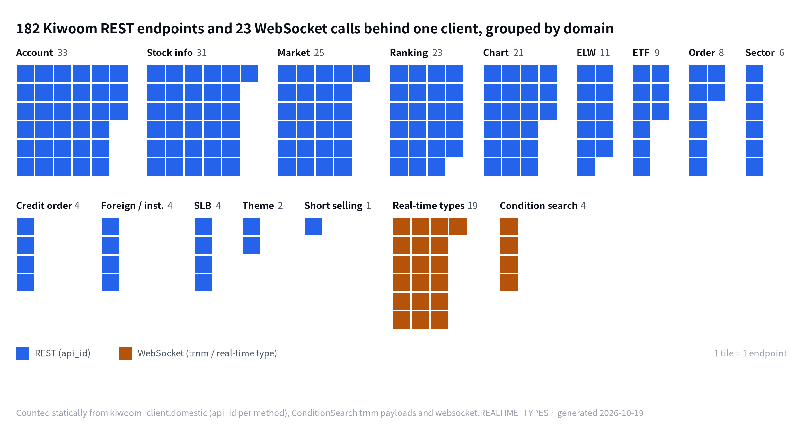
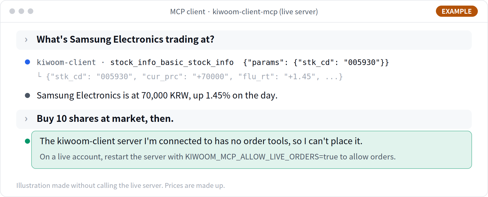

<div align="center">

<picture>
  <source media="(prefers-color-scheme: dark)" srcset="https://raw.githubusercontent.com/younghwan91/kiwoom-client/main/docs/images/brand/wordmark-dark.svg">
  
</picture>

# kiwoom-client

**The Kiwoom REST API, from Python and AI agents.**

An unofficial open-source client that runs on Windows, macOS, and Linux without OpenAPI+ COM/OCX.

[](https://pypi.org/project/kiwoom-client/)
[](https://pypi.org/project/kiwoom-client/)
[](https://github.com/younghwan91/kiwoom-client/actions/workflows/ci.yml)
[](https://github.com/younghwan91/kiwoom-client/blob/main/LICENSE)

[Docs](https://younghwan91.github.io/kiwoom-client/en/) · [Guide](https://younghwan91.github.io/kiwoom-client/en/guide/) · [Endpoints](https://younghwan91.github.io/kiwoom-client/en/endpoints/) · [한국어](https://github.com/younghwan91/kiwoom-client/blob/main/README.md)

</div>

<picture>
  <source media="(prefers-color-scheme: dark)" srcset="https://raw.githubusercontent.com/younghwan91/kiwoom-client/main/docs/images/hero-dark.png">
  
</picture>

<p align="center"><sub>182 REST endpoints, 4 condition-search calls, and 19 real-time types across 15 modules. One tile, one endpoint.</sub></p>

<p align="center">
  
</p>

<p align="center"><sub><b>Mock demo</b> — the real MCP server wired to a fake Kiwoom server (made-up prices), with the tool calls replayed from a script. No order is sent.</sub></p>

```bash
uvx --from 'kiwoom-client[mcp]' kiwoom-client-mcp            # start the MCP server (needs KIWOOM_APP_KEY / KIWOOM_APP_SECRET)
uv run --extra mcp python scripts/demo_mock_session.py      # replay the mock demo above, no keys (repo root)
```

## Quick start

```bash
pip install kiwoom-client
```

```python
from kiwoom_client import KiwoomAPI

api = KiwoomAPI.from_env(is_mock=True)  # KIWOOM_APP_KEY / KIWOOM_APP_SECRET env vars (or from_env(".env"))

info = api.stock_info.basic_stock_info(stk_cd=api.stock_code("삼성전자"))  # name -> 005930
chart = api.chart.stock_daily_chart(stk_cd="005930", base_dt="20260326", upd_stkpc_tp="1")  # daily chart
print(info["stk_nm"])
```

The access token is issued on the first call and refreshed before it expires. Get an app key and secret at the [Kiwoom REST API portal](https://openapi.kiwoom.com) and start on the mock server (`is_mock=True`). No key yet? `KiwoomAPI.demo()` lets you try it first ([demo mode](https://younghwan91.github.io/kiwoom-client/en/mcp/#demo-mode-try-it-without-a-key) — synthetic data, connects nowhere).

### From an AI agent (MCP)

With [uv](https://docs.astral.sh/uv/) it starts in one line, no install:

```bash
uvx --from 'kiwoom-client[mcp]' kiwoom-client-mcp
```

Add it to Claude Code (paper-trading keys, `KIWOOM_IS_MOCK=true`):

```bash
claude mcp add kiwoom -e KIWOOM_APP_KEY=YOUR_APP_KEY -e KIWOOM_APP_SECRET=YOUR_APP_SECRET \
  -e KIWOOM_IS_MOCK=true -- uvx --from 'kiwoom-client[mcp]' kiwoom-client-mcp
```

**Try it without a key** (from the release after 0.5.0): add `--demo` and it runs with no account or app key, on synthetic quotes and a made-up account. It connects to nothing, orders are paper trades in memory, and every response is marked as synthetic (these are not real quotes).

```bash
uvx --from 'kiwoom-client[mcp]' kiwoom-client-mcp --demo                         # just start the server
claude mcp add kiwoom -- uvx --from 'kiwoom-client[mcp]' kiwoom-client-mcp --demo   # register the demo in Claude Code
```

<details>
<summary>Claude Desktop · Cursor · Codex config</summary>

**Claude Desktop** — merge into `mcpServers` in `claude_desktop_config.json`.

```json
{
  "mcpServers": {
    "kiwoom": {
      "command": "uvx",
      "args": ["--from", "kiwoom-client[mcp]", "kiwoom-client-mcp"],
      "env": { "KIWOOM_APP_KEY": "YOUR_APP_KEY", "KIWOOM_APP_SECRET": "YOUR_APP_SECRET", "KIWOOM_IS_MOCK": "true" }
    }
  }
}
```

**Cursor** — the same JSON in `~/.cursor/mcp.json` or `<project>/.cursor/mcp.json`.

**Codex** — add to `~/.codex/config.toml`.

```toml
[mcp_servers.kiwoom]
command = "uvx"
args = ["--from", "kiwoom-client[mcp]", "kiwoom-client-mcp"]
env = { KIWOOM_APP_KEY = "YOUR_APP_KEY", KIWOOM_APP_SECRET = "YOUR_APP_SECRET", KIWOOM_IS_MOCK = "true" }
```

`kiwoom-client-mcp config <claude-code|claude-desktop|cursor|codex|vscode|gemini-cli>` prints the same config.

</details>

Ask Claude Code "What's Samsung Electronics trading at?" to query live quotes. Environment variables and the tool list are in the [MCP server docs](https://younghwan91.github.io/kiwoom-client/en/mcp/). Questions to paste as-is are in the [prompt library](https://younghwan91.github.io/kiwoom-client/en/prompts/).

<picture>
  <source media="(prefers-color-scheme: dark)" srcset="https://raw.githubusercontent.com/younghwan91/kiwoom-client/main/docs/images/demo-mcp-en-dark.png">
  
</picture>

<p align="center"><sub>Illustration made without calling the live server (prices are made up). On a live account, order tools are not registered until `KIWOOM_MCP_ALLOW_LIVE_ORDERS=true`.</sub></p>

## What it does

- **Cross-platform**: REST-based, so it runs on Windows, macOS, Linux, and headless servers.
- **Sync and async**: `KiwoomAPI` and `AsyncKiwoomAPI` expose the same endpoints.
- **Auto token and rate control**: Proactive token refresh, 401 reissue, and a per-TR rate limiter (1 req/s, burst 2) built in.
- **Auto pagination and parsing**: `request_all()` follows `cont-yn`/`next-key` to the end, and `to_dataframe()` turns string responses into numbers.
- **Real-time WebSocket**: 19 subscription types and condition search, with PING handling, reconnect, and re-subscribe.
- **MCP server built in**: All 15 REST modules and 4 condition-search calls exposed as tools, with an opt-in live-order guard.

## Installation and prerequisites

```bash
pip install kiwoom-client            # base
pip install 'kiwoom-client[pandas]'  # adds to_dataframe()
pip install 'kiwoom-client[mcp]'     # adds the MCP server
uv add kiwoom-client                 # if you use uv
```

Requires Python **3.10+**. See [`.env.example`](https://github.com/younghwan91/kiwoom-client/blob/main/.env.example) for environment variables.

| | Live | Mock |
|---|---|---|
| `is_mock` | `False` (default) | `True` |
| REST URL | `https://api.kiwoom.com` | `https://mockapi.kiwoom.com` |
| WebSocket URL | `wss://api.kiwoom.com:10000` | `wss://mockapi.kiwoom.com:10000` |

## Caveats

- **Defaults to the live server**: `KiwoomAPI(...)` defaults to `is_mock=False`. Direct Python calls have no order guard, so pass `is_mock=True` while testing.
- **Mock trading supports KRX only**: Live and mock app keys are separate pairs; match `is_mock` to your key.
- **WebSocket REAL item fields are unconfirmed**: LOGIN, PING, and REG are confirmed against the live server, while `item`/`values` field names need market-hours verification.

## Order safety

- **MCP server**: on the live server, order tools are not registered until `KIWOOM_MCP_ALLOW_LIVE_ORDERS=true`. Once on, the server still enforces checks such as `order_preview` confirm tokens, limits, an allow-list and de-duplication ([live-order guard](https://younghwan91.github.io/kiwoom-client/en/mcp/#live-order-guard)).
- **[kiwoom-order-guard](https://github.com/younghwan91/kiwoom-order-guard)** (Korean): a Claude Code hook that checks the amount, stock and count of orders sent through Kiwoom's official MCP or plugin before they go out. It works for agents that don't use kiwoom-client too.

## Works well with

| Repo | In one line |
|---|---|
| [krx-news-client](https://github.com/younghwan91/krx-news-client) | DART filings and Toss Securities news in one schema (Python) |
| [krx-fundamentals-client](https://github.com/younghwan91/krx-fundamentals-client) | Korean company fundamentals from DART, KRX and Naver as Pydantic models |
| [fin-checkup](https://github.com/younghwan91/fin-checkup) | MCP server that reads 17 financial-statement ratios as traffic lights, with formula and thresholds |
| [sector-flow](https://github.com/younghwan91/sector-flow) | Which sectors each investor group bought and sold today, on one map |

## Docs

| Doc | What's inside |
|---|---|
| [Usage Guide](https://younghwan91.github.io/kiwoom-client/en/guide/) | Accounts & orders, tick size, asyncio, DataFrame, WebSocket, pagination, rate limits, architecture, FAQ |
| [Endpoint reference](https://younghwan91.github.io/kiwoom-client/en/endpoints/) | All 182 REST methods with api_id, URL, and Korean TR name |
| [MCP server](https://younghwan91.github.io/kiwoom-client/en/mcp/) | Claude Code, Cursor, and Codex setup, tool list, live-order guard |
| [Conveniences](https://younghwan91.github.io/kiwoom-client/en/convenience/) | Stock search, named codes, read-only CLI, logging & timeouts |
| [Why kiwoom-client](https://younghwan91.github.io/kiwoom-client/en/why/) | Comparison with OpenAPI+, pykiwoom, and other REST wrappers |
| [Migrating from OpenAPI+](https://younghwan91.github.io/kiwoom-client/en/migration-from-openapi-plus/) | Mapping OCX functions and TR codes to REST |
| [Cookbook](https://younghwan91.github.io/kiwoom-client/en/cookbook/) | Runnable paper-trading recipes |
| [Troubleshooting](https://younghwan91.github.io/kiwoom-client/en/troubleshooting/) · [FAQ](https://younghwan91.github.io/kiwoom-client/en/faq/) | Fixes by error code and frequently asked questions |

## Contributing & support

- **Bugs & feature requests**: Open an issue in [GitHub Issues](https://github.com/younghwan91/kiwoom-client/issues).
- **Pull requests**: See [CONTRIBUTING.md](https://github.com/younghwan91/kiwoom-client/blob/main/CONTRIBUTING.md) for dev setup and rules.
- **Security**: Report live-order guard bypasses or key leaks privately via [SECURITY.md](https://github.com/younghwan91/kiwoom-client/blob/main/SECURITY.md).

## License

[MIT](https://github.com/younghwan91/kiwoom-client/blob/main/LICENSE) — an unofficial open-source project, not affiliated with or endorsed by Kiwoom Securities. "Kiwoom" is a trademark of Kiwoom Securities Co., Ltd.; this project is only a client for its public REST API.

<sub>Built by [Younghwan Chae (@younghwan91)](https://github.com/younghwan91) · Running daily in [quant-airflow](https://github.com/younghwan91/quant-airflow)</sub>
