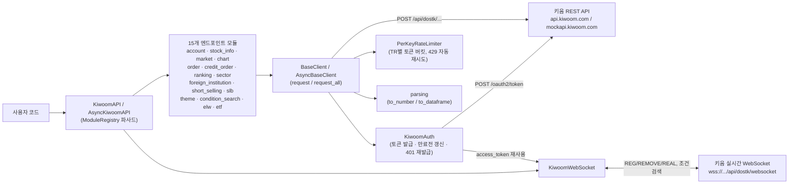

[한국어](README.md) | [English](README_EN.md)

# kiwoom-client — 키움증권 REST API 파이썬 클라이언트

키움 REST API 전체를 파이썬 클라이언트 하나로. 182개 엔드포인트, 실시간 WebSocket, 그리고 MCP 서버로 AI 에이전트까지 — COM/OCX 없이 Windows · macOS · Linux 어디서나 돌아갑니다.

[](https://pypi.org/project/kiwoom-client/)
[](https://pypi.org/project/kiwoom-client/)
[](https://pepy.tech/project/kiwoom-client)
[](https://github.com/younghwan91/kiwoom-client/actions/workflows/ci.yml)
[](https://github.com/younghwan91/kiwoom-client/blob/main/LICENSE)
[](https://pypi.org/project/kiwoom-client/)
[](https://www.linkedin.com/in/younghwan-chae/)

- **REST 182개 + 조건검색 4종 + 실시간 19종**을 모듈 15개로 감쌌습니다. 아래 그림은 코드에서 센 것이라 타일 하나가 엔드포인트 하나입니다.
- **MCP 서버 내장** — Claude Code · Cursor 가 `stock_info_basic_stock_info` 같은 도구로 시세·계좌·주문을 직접 부릅니다. 실전 계좌에서는 `KIWOOM_MCP_ALLOW_LIVE_ORDERS=true` 를 켜기 전까지 주문 도구가 **등록조차 되지 않습니다**.
- **봇이 토큰 만료로 죽지 않습니다** — 만료 전 자동 갱신, 401 이면 재발급 후 재시도. TR별 Rate Limiter 가 429 를 막고, 그래도 나오면 백오프 후 다시 보냅니다.

<picture>
  <source media="(prefers-color-scheme: dark)" srcset="docs/images/hero-dark.png">
  
</picture>

## 빠른 시작

```bash
pip install kiwoom-client
```

```python
from kiwoom_client import KiwoomAPI

api = KiwoomAPI(app_key="발급받은_앱키", app_secret="발급받은_시크릿키", is_mock=True)  # True=모의투자

info = api.stock_info.basic_stock_info(stk_cd="005930")                   # 삼성전자 기본 정보
chart = api.chart.stock_daily_chart(stk_cd="005930", base_dt="20260326")  # 일봉
print(info["stk_nm"])
```

접근토큰은 첫 호출에서 자동 발급되고 만료 전에 갱신되므로 따로 할 일이 없습니다. 앱키·시크릿키는
[키움 REST API 포털](https://openapi.kiwoom.com)에서 발급받고, 처음에는 모의투자(`is_mock=True`)로 시작하세요.
AI 에이전트에서 쓰려면 [MCP 서버](#mcp-서버로-사용하기)로 바로 가면 됩니다.

## 무엇을 하나

- **크로스 플랫폼**: REST 기반이라 Windows · macOS · Linux, 헤드리스 서버에서도 돌아갑니다.
- **sync / async 양쪽**: `KiwoomAPI` 와 `AsyncKiwoomAPI` 가 같은 엔드포인트를 제공합니다.
- **자동 토큰 관리**: 발급·만료 전 갱신·401 재발급을 라이브러리가 맡습니다.
- **내장 Rate Limiter**: TR(api_id)별 토큰 버킷(1 req/s, 버스트 2) + 429 자동 재시도.
- **자동 페이지네이션**: `request_all()` 이 `cont-yn`/`next-key` 를 끝까지 따라갑니다.
- **바로 쓰는 응답**: `to_dataframe()` 이 `"+70000"` 같은 문자열을 숫자로 바꿔 DataFrame 으로 넘깁니다.
- **호가단위 보정**: `round_to_tick()` 으로 지정가를 KRX 호가단위에 맞춥니다.
- **실시간 WebSocket**: 체결·호가·잔고 등 19종 구독, PING 응답·재연결·구독 복원 내장. 조건검색도 같은 소켓.
- **MCP 서버**: 모듈 15개의 REST 엔드포인트 전부와 조건검색 4종이 MCP 도구로 노출됩니다.

### 기존 키움 OpenAPI / pykiwoom 과 무엇이 다른가?

키움 **OpenAPI+(OCX/COM)** 와 이를 감싼 `pykiwoom` 은 32bit Windows 에 묶여 있어 서버 배포·자동화가 어렵습니다.
이 라이브러리는 키움의 **신규 REST API** 를 쓰므로 그 제약이 없습니다.

| 항목 | 키움 OpenAPI+ (OCX) | pykiwoom | **kiwoom-client** |
|------|---------------------|----------|---------------------|
| 연동 방식 | COM/OCX | OCX 래퍼 | **REST + WebSocket** |
| 운영체제 | Windows 전용 | Windows 전용 | **Windows · macOS · Linux** |
| Python 비트수 | 32bit 전용 | 32bit 전용 | **64bit 지원** |
| 서버/헤드리스 배포 | 어려움 (GUI 필요) | 어려움 | **가능** |
| 실시간 데이터 | 이벤트 콜백 | 이벤트 콜백 | **async WebSocket** |
| 설치 | 별도 모듈 설치 | OCX + 모듈 | **`pip install` 한 줄** |

## 설치와 사전 준비

```bash
pip install kiwoom-client            # 기본
pip install 'kiwoom-client[pandas]'  # to_dataframe() 까지
pip install 'kiwoom-client[mcp]'     # MCP 서버까지
uv add kiwoom-client                 # uv 를 쓴다면
```

- Python **3.10 이상**. 소스에서 쓰려면 `git clone` 뒤 `pip install -e .`
- [키움 REST API 포털](https://openapi.kiwoom.com)에서 **API 사용신청**으로 앱키·시크릿키를 발급받습니다. 환경변수는 [`.env.example`](.env.example) 참고.
- 모의투자용 키와 실전투자용 키는 다릅니다. `is_mock` 과 짝이 맞지 않으면 인증이 거부됩니다.

| 구분 | 실전투자 | 모의투자 |
|------|---------|---------|
| `is_mock` | `False` (기본값) | `True` |
| REST URL | `https://api.kiwoom.com` | `https://mockapi.kiwoom.com` |
| WebSocket URL | `wss://api.kiwoom.com:10000` | `wss://mockapi.kiwoom.com:10000` |

## 사용법

### 계좌와 주문

```python
evaluation = api.account.account_evaluation()   # 계좌 평가 현황
deposit = api.account.deposit_detail()          # 예수금 상세
position = api.account.filled_position()        # 체결 잔고
unfilled = api.account.unfilled_orders()        # 미체결 주문

# 삼성전자 10주 지정가 매수
result = api.order.buy_order(
    dmst_stex_tp="01",   # 거래소 구분 (01: KRX)
    stk_cd="005930",     # 종목코드
    ord_qty=10,          # 주문 수량
    trde_tp="00",        # 주문 유형 (00: 지정가)
    ord_uv=70000,        # 주문 단가
)
api.order.sell_order(dmst_stex_tp="01", stk_cd="005930", ord_qty=10, trde_tp="00", ord_uv=75000)
api.order.modify_order(org_ord_no="원래주문번호", ord_qty=5, ord_uv=71000)   # 정정
api.order.cancel_order(org_ord_no="원래주문번호", ord_qty=5)                 # 취소

api.logout()  # 토큰 폐기 (선택)
api.close()   # 연결 종료 — with 문을 쓰면 자동
```

지정가(`ord_uv`)는 KRX 호가단위의 배수여야 합니다. 아니면 거부되거나 의도와 다른 가격에 체결됩니다.

```python
from kiwoom_client import round_to_tick, tick_size

tick_size(70123)        # Decimal('100')   (5만~20만원대는 1틱 100원)
round_to_tick(70123)    # Decimal('70100') (직전 유효 호가로 내림)

api.order.buy_order(
    dmst_stex_tp="01", stk_cd="005930", ord_qty=10,
    trde_tp="00", ord_uv=round_to_tick(target_price),
)
```

### asyncio

`AsyncKiwoomAPI` 는 `KiwoomAPI` 와 같은 엔드포인트를 제공하며, 호출 앞에 `await` 만 붙이면 됩니다.

```python
import asyncio
from kiwoom_client import AsyncKiwoomAPI

async def main():
    async with AsyncKiwoomAPI(app_key="앱키", app_secret="시크릿키", is_mock=True) as api:
        # 서로 다른 TR은 동시에 나간다 — 직렬로 돌리면 3배 걸린다
        info, chart, ranking = await asyncio.gather(
            api.stock_info.basic_stock_info(stk_cd="005930"),
            api.chart.stock_daily_chart(stk_cd="005930", base_dt="20260326"),
            api.ranking.top_volume_today(
                mrkt_tp="0", stk_cnd="0", trde_qty_tp="0",
                prc_tp="0", trde_amt_tp="0", updn_tp="0",
            ),
        )
        print(info["stk_nm"])

asyncio.run(main())
```

Rate Limiter 는 TR(api_id)별로 걸립니다. 서로 다른 TR 은 서로를 막지 않고 동시에 나가며,
같은 TR 을 반복 호출할 때만 초당 1건으로 조여집니다. 전체 예제는 [`examples/async_usage.py`](examples/async_usage.py).

### 응답을 숫자·DataFrame으로 받기

키움은 모든 값을 문자열로 돌려줍니다. 가격은 `"+70000"`, 등락률은 `"-1.23"`, 거래량은 `"1,234,567"` 같은 식이라 그대로는 계산에 쓸 수 없습니다.

```python
from kiwoom_client import to_dataframe, to_number, normalize

result = api.ranking.top_volume_today(...)

df = to_dataframe(result)     # 페이로드 키를 자동으로 찾아 DataFrame 으로 (문자열 → 숫자 포함)
print(df["cur_prc"].mean())   # 바로 계산 가능

data = normalize(result)      # dict 그대로 쓰고 싶다면
price = to_number("+70000")   # 70000
```

종목코드(`"005930"`)처럼 앞자리 0 이 의미를 갖는 값과 `base_dt` 같은 날짜·식별자 필드는 문자열로 남깁니다.
`to_dataframe()` 에는 pandas 가 필요합니다(`pip install 'kiwoom-client[pandas]'`).


<sub>샘플 응답을 `to_dataframe()` 에 넣은 실제 출력입니다. 시세 값 자체는 예시입니다 — `stk_cd` 는 문자열로 남고 가격·거래량만 숫자가 되는 것을 보세요.</sub>

### 실시간 WebSocket

```python
import asyncio
from kiwoom_client import KiwoomAPI

api = KiwoomAPI(app_key="앱키", app_secret="시크릿키")
ws = api.create_websocket()

async def main():
    # connect()가 LOGIN 핸드셰이크까지 끝냅니다. 실패하면 KiwoomWebSocketError
    await ws.connect()

    # 콜백은 REAL 프레임의 항목 하나를 받습니다:
    # {"type": "0B", "item": "005930", "values": {"10": "+70000", ...}}
    ws.on("0B", lambda d: print(f"체결 {d['item']}: {d['values'].get('10')}"))
    ws.on("0D", lambda d: print(f"호가 {d['item']}: {d['values'].get('41')}"))

    # async 콜백도 그대로 등록할 수 있습니다
    async def save(d): ...
    ws.on("0B", save)

    # 삼성전자 실시간 체결+호가 구독
    await ws.subscribe("0B", "005930")
    await ws.subscribe(["0B", "0D"], ["005930", "000660", "035420"])

    # PING 응답과 재연결(재로그인·구독 복원)은 listen()이 알아서 처리합니다
    await ws.listen()

asyncio.run(main())
```

`values` 의 키는 키움 FID 번호입니다(10=현재가, 13=누적거래량, 41=매도최우선호가).

조건검색도 같은 WebSocket 을 씁니다. `api.condition_search` 가 요청 페이로드를 만들고, `ws.send()` 로 보낸 뒤 `ws.on_trnm()` 으로 응답을 받습니다.

```python
await ws.connect()
ws.on_trnm("CNSRLST", lambda d: print("조건식 목록:", d["data"]))
ws.on_trnm("CNSRREQ", lambda d: print("검색 결과:", d.get("data")))

# 조건식 목록을 먼저 조회해야 seq를 알 수 있습니다
await ws.send(api.condition_search.condition_list())

# seq로 검색 (search_type="1"이면 실시간 편입/이탈까지 수신)
await ws.send(api.condition_search.condition_search_realtime(seq="1"))
await ws.listen()
```

> **검증 상태**: 실서버(api.kiwoom.com) 대상으로 LOGIN 핸드셰이크 · PING 프레임 · REG 등록 응답까지 확인했습니다.
> 다만 **REAL 프레임의 항목 필드명(`item`/`values`)은 장 마감 중이라 아직 미확정**입니다. 장중 이상 동작을 만나면
> [이슈](https://github.com/younghwan91/kiwoom-client/issues)로 알려주세요. 직접 확인하려면 `python tests/integration_ws_smoke.py --prod`.

### 연속 조회 (페이지네이션)

응답 헤더의 `cont-yn` 이 `"Y"` 이면 다음 페이지가 있다는 뜻입니다. `request_all()` 이 끝까지 따라갑니다.

```python
all_data = api._client.request_all(
    "/api/dostk/acnt", "ka10076",
    data_key="filled_list",  # 응답에서 리스트 데이터의 키 이름
)
```

### 요청 제한 (Rate Limit)

키움 REST API 는 **TR(api_id)별로 독립적인** 호출 제한을 둡니다. 실측 결과:

| 항목 | 측정값 |
|---|---|
| 지속(sustained) 안전 속도 | **TR당 약 1 req/s** (이 속도에선 거부 0) |
| 순간 버스트(burst) 허용량 | **TR당 약 2건** |
| 초과 시 응답 | HTTP `429` + `{"return_code": 5, "return_msg": "허용된 요청 개수를 초과하였습니다"}` |
| 제한 단위 | **TR(api_id)별 독립** — 서로 다른 TR은 영향 없음 |

라이브러리는 기본으로 **TR별 토큰 버킷(1 req/s, 버스트 2)** 을 걸고, 그래도 `429` 가 나면 **백오프 후 재시도**합니다.

```python
api = KiwoomAPI(app_key="...", app_secret="...")                                  # 기본값
api = KiwoomAPI(app_key="...", app_secret="...", rate_limit=2.0, rate_burst=3, max_retries=5)  # 직접 조정
api = KiwoomAPI(app_key="...", app_secret="...", rate_limit=None)                 # 클라이언트 측 스로틀 끄기
```

> 서로 다른 TR 을 섞어 호출하면 합산 처리량은 더 높습니다. 같은 TR 을 반복(연속조회 루프 등)할 때는 1 req/s 에 수렴합니다 — 이 경우 `request_all()` 을 쓰세요.

### 에러 처리

```python
from kiwoom_client.base import KiwoomAPIError

try:
    result = api.order.buy_order(stk_cd="005930", ord_qty=10, ord_uv=70000)
except KiwoomAPIError as e:
    print(f"에러 코드: {e.code}")
    print(f"에러 메시지: {e.message}")
    print(f"전체 응답: {e.response}")
```

## MCP 서버로 사용하기

Claude Code, Cursor 등 MCP(Model Context Protocol) 클라이언트에서 이 라이브러리를 직접 부릅니다. 모듈 15개의 REST 엔드포인트 전부와 조건검색 4종이 MCP 도구로 노출됩니다.

```bash
pip install 'kiwoom-client[mcp]'
```

MCP 클라이언트 설정(예: Claude Code `.mcp.json`)에 추가:

```json
{
  "mcpServers": {
    "kiwoom-client": {
      "command": "kiwoom-client-mcp",
      "env": {
        "KIWOOM_APP_KEY": "발급받은_앱키",
        "KIWOOM_APP_SECRET": "발급받은_시크릿키",
        "KIWOOM_IS_MOCK": "true"
      }
    }
  }
}
```

| 환경변수 | 설명 | 기본값 |
|---|---|---|
| `KIWOOM_APP_KEY` | 앱키 (필수) | — |
| `KIWOOM_APP_SECRET` | 시크릿키 (필수) | — |
| `KIWOOM_IS_MOCK` | 모의투자 서버 사용 여부 | `false` |
| `KIWOOM_MCP_ALLOW_LIVE_ORDERS` | 실전투자 계좌에서 주문 도구(매수/매도/정정/취소·신용주문)를 노출할지 여부 | `false` |

**실주문 가드**: `KIWOOM_IS_MOCK=false`(실전투자)이고 `KIWOOM_MCP_ALLOW_LIVE_ORDERS` 가 `true` 가 아니면, 주문 관련 도구는 서버 시작 시점에 아예 등록되지 않습니다 — AI 에이전트가 그 도구의 존재 자체를 모릅니다. 모의투자(`KIWOOM_IS_MOCK=true`)는 이 가드 없이 항상 사용 가능합니다. 가드는 MCP 서버 경로에만 적용되며, 파이썬 코드에서 `KiwoomAPI`/`AsyncKiwoomAPI` 를 직접 쓰는 방식에는 영향이 없습니다.

조회성 도구는 `{"params": {...}}` 형태로 TR 요청 필드를 그대로 전달합니다(필드 목록은 [키움 REST API 가이드](https://openapi.kiwoom.com)). 예: `stock_info_basic_stock_info` 도구에 `{"params": {"stk_cd": "005930"}}`.

## 아키텍처

`KiwoomAPI`(sync) / `AsyncKiwoomAPI`(async) 는 같은 구조를 공유하는 파사드입니다. 15개 엔드포인트 모듈은 `ModuleRegistry` 가 지연 생성하고, HTTP 호출·인증·재시도는 `BaseClient`/`AsyncBaseClient` 한 곳에 모여 있습니다. 실시간 데이터는 `KiwoomWebSocket` 이 같은 토큰을 재사용해 처리합니다.



## 지원 API 목록

```python
api.login()      # 접근토큰 발급 (선택 — 첫 호출에서 자동 발급됩니다)
api.logout()     # 접근토큰 폐기
```

| 모듈 | 개수 | 설명 |
|---|---|---|
| `api.account` | 33 | 계좌 — 예수금·잔고·손익·증거금·주문내역 |
| `api.stock_info` | 31 | 종목정보 — 기본정보·거래원·신용동향·업종코드 |
| `api.market` | 25 | 시세 — 호가·기관/외국인 매매·프로그램매매 |
| `api.ranking` | 23 | 순위정보 — 거래량·등락률·신용비율·외국인 상위 |
| `api.chart` | 21 | 차트 — 틱·분·일·주·월·년봉 (종목·업종·금현물) |
| `api.elw` | 11 | ELW — 민감도지표·괴리율·조건검색 |
| `api.etf` | 9 | ETF — 수익율·시세·시간대별 체결 |
| `api.order` | 8 | 주문 — 매수·매도·정정·취소 (금현물 포함) |
| `api.sector` | 6 | 업종 — 현재가·지수·투자자 순매수 |
| `api.credit_order` | 4 | 신용주문 — 매수·매도·정정·취소 |
| `api.foreign_institution` | 4 | 기관/외국인 매매 동향 |
| `api.slb` | 4 | 대차거래 — 추이·상위종목 |
| `api.condition_search` | 4 | 조건검색 (WebSocket, `trnm` 기반) |
| `api.theme` | 2 | 테마 — 그룹·구성종목 |
| `api.short_selling` | 1 | 공매도 추이 |
| `api.create_websocket()` | 19종 | 실시간 시세 — 체결·호가·잔고·VI 등 |

메서드 이름과 파라미터 전체 목록은 [`src/kiwoom_client/domestic/`](src/kiwoom_client/domestic/) 소스나 IDE 자동완성으로 확인할 수 있습니다. API ID(`ka10001` 등)는 키움 공식 가이드의 TR 코드와 같습니다.

## 자주 묻는 질문 (FAQ)

**Q. sync(`KiwoomAPI`)와 async(`AsyncKiwoomAPI`) 중 뭘 써야 하나요?**
단발성 조회·간단한 스크립트라면 sync 로 충분합니다. 여러 종목을 동시에 조회하거나 실시간 WebSocket 과 함께 쓴다면 async 가 유리합니다.

**Q. 인증 에러(`유효하지 않은 토큰` 등)가 나요.**
토큰 만료라면 라이브러리가 자동으로 재발급 후 재시도합니다. 계속 실패한다면 `is_mock` 값과 앱키/시크릿키가 서로 맞는지 확인하세요 — 모의투자용 키로 실전투자 서버를(또는 반대로) 호출하면 인증이 거부됩니다.

**Q. HTTP `429` 가 계속 떠요.**
기본 Rate Limiter(TR당 1 req/s, 버스트 2)가 있어도, 같은 TR 을 여러 프로세스나 스레드에서 동시에 호출하면 넘길 수 있습니다. `rate_limit` 을 낮추거나 호출을 한 곳에서 조율하세요. [요청 제한](#요청-제한-rate-limit) 참고.

**Q. 지정가 주문(`buy_order`/`sell_order`)이 거부돼요.**
`ord_uv` 가 KRX 호가단위의 배수가 아니면 거부되거나 의도와 다른 가격에 체결됩니다. [`round_to_tick()`](#계좌와-주문)으로 보정한 값을 넘기세요.

**Q. pandas 없이도 쓸 수 있나요?**
네. `to_dataframe()` 만 pandas 가 필요하고, 기본 설치는 dict/list 형태 그대로 응답을 돌려줍니다.

**Q. 연속조회를 직접 관리하지 않고 한 번에 다 받고 싶어요.**
`request_all()` 을 쓰세요. `cont-yn`/`next-key` 를 자동으로 순회합니다. [연속 조회](#연속-조회-페이지네이션) 참고.

더 궁금한 점은 [Issues](https://github.com/younghwan91/kiwoom-client/issues)에 남겨주세요.

## 어디서 쓰이나

[quant-airflow](https://github.com/younghwan91/quant-airflow)의 일일 수집 DAG 가 이 라이브러리로 시세·수급·신용·공매도를 매일 TimescaleDB 에 적재합니다. 같은 스택의 나머지는 [아래](#관련-프로젝트--오픈소스-퀀트-스택)에 있습니다.

<picture>
  <source media="(prefers-color-scheme: dark)" srcset="docs/images/pypi_downloads_dark.png">
  
</picture>

## 참고

- 공식 API 가이드: https://openapi.kiwoom.com/guide/apiguide
- 모의투자는 KRX 만 지원됩니다.
- 모든 API 이름은 키움증권 공식 가이드 기준입니다.

## 라이선스

MIT

## 기여 및 이슈 제보

- 🐛 버그 제보 및 기능 요청: [GitHub Issues](https://github.com/younghwan91/kiwoom-client/issues)
- 💡 새로운 기능 제안 및 PR 환영: [CONTRIBUTING.md](CONTRIBUTING.md) 가이드라인을 확인해 주세요.

## 관련 프로젝트 — 오픈소스 퀀트 스택

한국·미국 주식과 암호화폐를 아우르는 오픈소스 스택입니다. 각 저장소는 독립적으로 쓸 수 있습니다.

| 축 | 프로젝트 | 설명 |
|---|---|---|
| 🇰🇷 한국 주식 | **[krx-fundamentals-client](https://github.com/younghwan91/krx-fundamentals-client)** | 국내 기업 펀더멘탈 Python 클라이언트 라이브러리 — 재무제표·투자지표·배당·종목 스크리닝 (DART + KRX + 네이버) |
| 🇰🇷 한국 주식 | **[krx-news-client](https://github.com/younghwan91/krx-news-client)** | 한국 주식 뉴스·공시를 한 스키마로 내주는 Python 클라이언트 라이브러리 (DART + 토스증권) |
| 🇰🇷 한국 주식 | **[krx-quant-core](https://github.com/younghwan91/krx-quant-core)** | 한국 주식 퀀트 시스템 공통 Python 코어 — KRX 호가·가격제한폭·세션 규칙, 시행일별 거래세 비용모델, 키움 주문 가드, DART 중대공시 위험 분류, 체결 시뮬레이션, Deflated Sharpe·purged CV 통계 |
| 🇰🇷 한국 주식 | **[fin-checkup](https://github.com/younghwan91/fin-checkup)** | 관심종목 위험 공시 텔레그램 알림 + DART·SEC 재무 건강검진 — 측정값과 사실만 전달한다 |
| 🇰🇷 한국 주식 | **[quant-airflow](https://github.com/younghwan91/quant-airflow)** | 시세·수급·실적을 TimescaleDB 로 수집하는 Airflow 파이프라인 — 상장폐지 종목까지 담아 생존편향을 막는다 |
| 🇰🇷 한국 주식 | **[swing-it](https://github.com/younghwan91/swing-it)** | 코스피·코스닥 알파 심사 프레임워크 — 개별 트레이드 분포로 판정하고 랜덤 음성대조·purged CV·Deflated Sharpe 를 CI 가드레일로 강제 |
| 🇺🇸 미국 주식 | **[portfolio-research](https://github.com/younghwan91/portfolio-research)** | 미국주식 팩터 엔진 — point-in-time·생존편향 보정 데이터 위에서 walk-forward 를 Deflated Sharpe·PBO 로 게이팅하고 ETF 전술배분도 같은 관문을 지난다 |
| 🇺🇸 미국 주식 | **[macro-sector-agent](https://github.com/younghwan91/macro-sector-agent)** | 하향식 미국 산업 사이클 리서치 — \"어느 산업이 잊혔나\"를 묻고 기계는 제외만 한다 |
| 🇺🇸 미국 주식 | **[automated-stock-trading-systems](https://github.com/younghwan91/automated-stock-trading-systems)** | Bensdorp 의 7개 비상관 트레이딩 시스템 백테스터 (교육용 재구현) |
| ₿ 암호화폐 | **[binance-quant-engine](https://github.com/younghwan91/binance-quant-engine)** | 암호화폐 선물 백테스트·실행 엔진 — 룩어헤드 0, 백테스트↔실거래 일체화 |
| ₿ 암호화폐 | **[crypto-quant-insights](https://github.com/younghwan91/crypto-quant-insights)** | 실거래 선물 시스템을 검증하며 나온 차트 연구 노트 — 폭락 스트레스 테스트·Kelly 레버리지·체결 간극 |

## 만든 사람

**채영환 (Younghwan Chae)** · [GitHub @younghwan91](https://github.com/younghwan91) · [LinkedIn](https://www.linkedin.com/in/younghwan-chae/)

전체 오픈소스 퀀트 스택은 [프로필](https://github.com/younghwan91)에서 한눈에 볼 수 있습니다.
