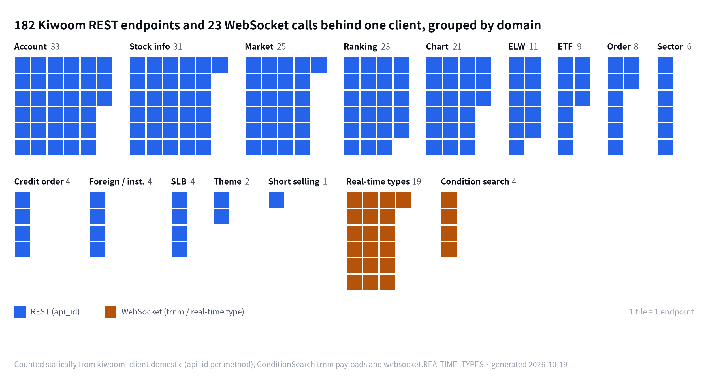
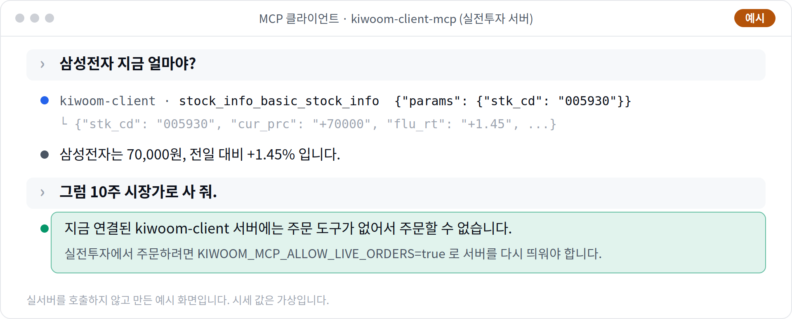

<div align="center">

<picture>
  <source media="(prefers-color-scheme: dark)" srcset="https://raw.githubusercontent.com/younghwan91/kiwoom-client/main/docs/images/brand/wordmark-dark.svg">
  
</picture>

# kiwoom-client

**키움 REST API, 파이썬과 AI 에이전트로.**

OpenAPI+의 COM/OCX 없이 Windows · macOS · Linux 어디서나 동작하는 비공식 오픈소스 클라이언트입니다.

[](https://pypi.org/project/kiwoom-client/)
[](https://pypi.org/project/kiwoom-client/)
[](https://github.com/younghwan91/kiwoom-client/actions/workflows/ci.yml)
[](https://github.com/younghwan91/kiwoom-client/blob/main/LICENSE)

[문서 사이트](https://younghwan91.github.io/kiwoom-client/) · [사용 가이드](https://younghwan91.github.io/kiwoom-client/guide/) · [엔드포인트](https://younghwan91.github.io/kiwoom-client/endpoints/) · [English](https://github.com/younghwan91/kiwoom-client/blob/main/README.en.md)

</div>

<picture>
  <source media="(prefers-color-scheme: dark)" srcset="https://raw.githubusercontent.com/younghwan91/kiwoom-client/main/docs/images/hero-dark.png">
  
</picture>

<p align="center"><sub>REST 엔드포인트 182개, 조건검색 4종, 실시간 19종을 15개 모듈로 감쌌습니다. 타일 하나가 엔드포인트 하나입니다.</sub></p>

<p align="center">
  
</p>

<p align="center"><sub><b>모의 데모</b> — 진짜 MCP 서버에 가짜 키움 서버(가상 시세)를 붙이고 도구 호출을 스크립트로 재생했습니다. 주문은 나가지 않습니다.</sub></p>

```bash
uvx --from 'kiwoom-client[mcp]' kiwoom-client-mcp            # MCP 서버 시작 (KIWOOM_APP_KEY·KIWOOM_APP_SECRET 필요)
uv run --extra mcp python scripts/demo_mock_session.py      # 위 모의 데모를 키 없이 재생 (레포 루트)
```

## 빠른 시작

```bash
pip install kiwoom-client
```

```python
from kiwoom_client import KiwoomAPI

api = KiwoomAPI.from_env(is_mock=True)  # KIWOOM_APP_KEY·KIWOOM_APP_SECRET 환경변수 (.env 는 from_env(".env"))

info = api.stock_info.basic_stock_info(stk_cd=api.stock_code("삼성전자"))  # 종목명 → 005930
chart = api.chart.stock_daily_chart(stk_cd="005930", base_dt="20260326", upd_stkpc_tp="1")  # 일봉
print(info["stk_nm"])
```

접근토큰은 첫 호출에서 자동 발급되며 만료 전에 갱신됩니다. 앱키·시크릿키는 [키움 REST API 포털](https://openapi.kiwoom.com)에서 발급받고, 처음에는 모의투자(`is_mock=True`)로 시작하세요.

### AI 에이전트에서 (MCP)

<!-- mcp-name: io.github.younghwan91/kiwoom-client (MCP 레지스트리 PyPI 소유 확인용, server.json 참고) -->

[uv](https://docs.astral.sh/uv/)가 있으면 설치 없이 한 줄로 띄웁니다.

```bash
uvx --from 'kiwoom-client[mcp]' kiwoom-client-mcp
```

Claude Code 에는 이렇게 붙입니다(키는 모의투자 키, `KIWOOM_IS_MOCK=true`).

```bash
claude mcp add kiwoom -e KIWOOM_APP_KEY=YOUR_APP_KEY -e KIWOOM_APP_SECRET=YOUR_APP_SECRET \
  -e KIWOOM_IS_MOCK=true -- uvx --from 'kiwoom-client[mcp]' kiwoom-client-mcp
```

<details>
<summary>Claude Desktop · Cursor · Codex 설정</summary>

**Claude Desktop** — `claude_desktop_config.json` 의 `mcpServers` 에 병합합니다.

```json
{
  "mcpServers": {
    "kiwoom": {
      "command": "uvx",
      "args": ["--from", "kiwoom-client[mcp]", "kiwoom-client-mcp"],
      "env": { "KIWOOM_APP_KEY": "YOUR_APP_KEY", "KIWOOM_APP_SECRET": "YOUR_APP_SECRET", "KIWOOM_IS_MOCK": "true" }
    }
  }
}
```

**Cursor** — 같은 JSON 을 `~/.cursor/mcp.json` 또는 `<프로젝트>/.cursor/mcp.json` 에 넣습니다.

**Codex** — `~/.codex/config.toml` 에 추가합니다.

```toml
[mcp_servers.kiwoom]
command = "uvx"
args = ["--from", "kiwoom-client[mcp]", "kiwoom-client-mcp"]
env = { KIWOOM_APP_KEY = "YOUR_APP_KEY", KIWOOM_APP_SECRET = "YOUR_APP_SECRET", KIWOOM_IS_MOCK = "true" }
```

`kiwoom-client-mcp config <claude-code|claude-desktop|cursor|codex|vscode|gemini-cli>` 가 같은 설정을 출력합니다.

</details>

이제 Claude Code에서 "삼성전자 지금 얼마야?"라고 물으면 시세를 조회합니다. 환경변수와 도구 목록은 [MCP 서버 문서](https://younghwan91.github.io/kiwoom-client/mcp/)를 참고하세요.

<picture>
  <source media="(prefers-color-scheme: dark)" srcset="https://raw.githubusercontent.com/younghwan91/kiwoom-client/main/docs/images/demo-mcp-ko-dark.png">
  
</picture>

<p align="center"><sub>실서버를 호출하지 않고 만든 예시 화면입니다(시세 값은 가상). 실전투자 서버에서는 `KIWOOM_MCP_ALLOW_LIVE_ORDERS=true`를 켜기 전까지 주문 도구가 등록되지 않습니다.</sub></p>

## 무엇을 하나

- **크로스 플랫폼**: REST 기반이라 Windows · macOS · Linux와 헤드리스 서버에서 모두 동작합니다.
- **sync / async 동시 지원**: `KiwoomAPI`와 `AsyncKiwoomAPI`가 같은 엔드포인트를 제공합니다.
- **자동 토큰·속도 제어**: 토큰 발급·만료 전 갱신·401 재발급과 TR별 Rate Limiter(1 req/s, 버스트 2)를 내장했습니다.
- **자동 페이지네이션과 파싱**: `request_all()`이 연속조회를 끝까지 따라가고, `to_dataframe()`이 문자열 응답을 숫자로 바꿉니다.
- **실시간 WebSocket**: 체결·호가·잔고 등 19종 구독과 조건검색, PING 응답·재연결·구독 복원을 지원합니다.
- **MCP 서버 내장**: 15개 모듈의 REST 엔드포인트 전부와 조건검색 4종, 실전 주문 opt-in 가드를 제공합니다.

## 설치와 환경 설정

```bash
pip install kiwoom-client            # 기본
pip install 'kiwoom-client[pandas]'  # to_dataframe() 포함
pip install 'kiwoom-client[mcp]'     # MCP 서버 포함
uv add kiwoom-client                 # uv 프로젝트
```

Python **3.10 이상**이 필요합니다. 환경변수 목록은 [`.env.example`](https://github.com/younghwan91/kiwoom-client/blob/main/.env.example)을 참고하세요.

| 구분 | 실전투자 | 모의투자 |
|---|---|---|
| `is_mock` | `False` (기본값) | `True` |
| REST URL | `https://api.kiwoom.com` | `https://mockapi.kiwoom.com` |
| WebSocket URL | `wss://api.kiwoom.com:10000` | `wss://mockapi.kiwoom.com:10000` |

## 주의 사항

- **기본값은 실전투자 서버입니다**: `KiwoomAPI(...)`의 기본값은 `is_mock=False`입니다. 파이썬 직접 호출에는 주문 가드가 없으므로 테스트 시 `is_mock=True`를 사용하세요.
- **모의투자는 KRX만 지원합니다**: 실전투자와 모의투자의 앱키·시크릿키는 서로 다르므로 `is_mock`과 맞춰야 합니다.
- **WebSocket REAL 항목 필드명은 미확정입니다**: LOGIN · PING · REG 응답은 실서버에서 확인했으나 `item`/`values` 필드명은 장중 검증이 필요합니다.

## 주문 안전장치

- **MCP 서버**: 실전투자 서버에서는 `KIWOOM_MCP_ALLOW_LIVE_ORDERS=true` 를 켜기 전까지 주문 도구가 등록되지 않습니다. 켠 뒤에도 `order_preview` 확인 토큰·한도·허용 종목·중복 방지 같은 장치가 서버에서 동작합니다([실주문 가드](https://younghwan91.github.io/kiwoom-client/mcp/#실주문-가드)).
- **[kiwoom-order-guard](https://github.com/younghwan91/kiwoom-order-guard)**: 키움 공식 MCP·플러그인으로 내는 주문도 전송 전에 금액·종목·횟수를 검사하는 Claude Code 훅입니다. kiwoom-client 를 쓰지 않는 에이전트에도 붙일 수 있습니다.

## 같이 쓰면 좋은 것

| 레포 | 한 줄 소개 |
|---|---|
| [krx-news-client](https://github.com/younghwan91/krx-news-client) | DART 공시와 토스증권 뉴스를 한 스키마로 받는 파이썬 클라이언트 |
| [krx-fundamentals-client](https://github.com/younghwan91/krx-fundamentals-client) | DART·KRX·네이버의 기업 펀더멘탈을 Pydantic 모델로 돌려주는 라이브러리 |
| [fin-checkup](https://github.com/younghwan91/fin-checkup) | 상장사 재무제표 지표 17개를 계산식·경계값과 함께 신호등으로 보여 주는 MCP 서버 |
| [sector-flow](https://github.com/younghwan91/sector-flow) | 투자 주체별 순매매로 오늘 어느 섹터에 돈이 들고 났는지 한 장의 지도로 보여 줍니다 |

## 문서

| 문서 | 내용 |
|---|---|
| [사용 가이드](https://younghwan91.github.io/kiwoom-client/guide/) | 계좌·주문, 호가단위, asyncio, DataFrame, WebSocket, 연속조회, Rate Limit, 아키텍처, FAQ |
| [엔드포인트 전체 목록](https://younghwan91.github.io/kiwoom-client/endpoints/) | 182개 REST 메서드의 api_id·URL·한글 TR 이름 |
| [MCP 서버](https://younghwan91.github.io/kiwoom-client/mcp/) | Claude Code · Cursor · Codex 설정, 도구 목록, 실주문 가드 |
| [편의 기능](https://younghwan91.github.io/kiwoom-client/convenience/) | 종목 검색, 코드값 상수, 조회 CLI, 로깅·타임아웃 |
| [왜 kiwoom-client 인가](https://younghwan91.github.io/kiwoom-client/why/) | OpenAPI+ · pykiwoom · 다른 REST 래퍼와 비교 |
| [OpenAPI+에서 옮겨 오기](https://younghwan91.github.io/kiwoom-client/migration-from-openapi-plus/) | OCX 함수 · TR 코드의 REST 대응표 |
| [Cookbook](https://younghwan91.github.io/kiwoom-client/cookbook/) | 바로 실행할 수 있는 모의투자 레시피 모음 |
| [문제 해결](https://younghwan91.github.io/kiwoom-client/troubleshooting/) · [FAQ](https://younghwan91.github.io/kiwoom-client/faq/) | 에러 코드별 해결 방법과 자주 묻는 질문 |

## 기여 및 지원

- **버그 제보 및 기능 요청**: [GitHub Issues](https://github.com/younghwan91/kiwoom-client/issues)에서 접수합니다.
- **기여 안내**: 개발 환경과 테스트 규칙은 [CONTRIBUTING.md](https://github.com/younghwan91/kiwoom-client/blob/main/CONTRIBUTING.md)를 확인하세요.
- **보안 제보**: 실주문 가드 우회나 키 유출 문제는 [SECURITY.md](https://github.com/younghwan91/kiwoom-client/blob/main/SECURITY.md)의 비공개 경로로 알려주세요.

## 라이선스

[MIT](https://github.com/younghwan91/kiwoom-client/blob/main/LICENSE) — 키움증권과 무관한 비공식 오픈소스 프로젝트입니다. "키움"·"Kiwoom"은 키움증권(주)의 상표이며, 이 프로젝트는 키움증권이 공개한 REST API를 호출하는 클라이언트일 뿐입니다.

<sub>만든 사람: [채영환 (@younghwan91)](https://github.com/younghwan91) · [quant-airflow](https://github.com/younghwan91/quant-airflow)에서 매일 사용 중</sub>
