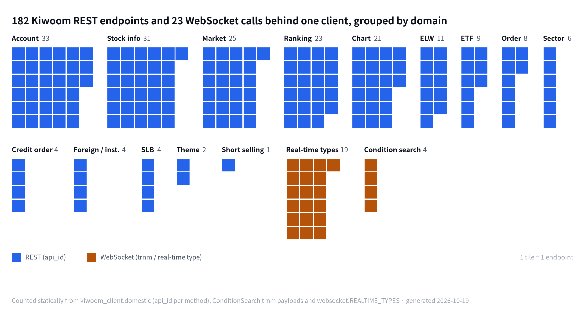
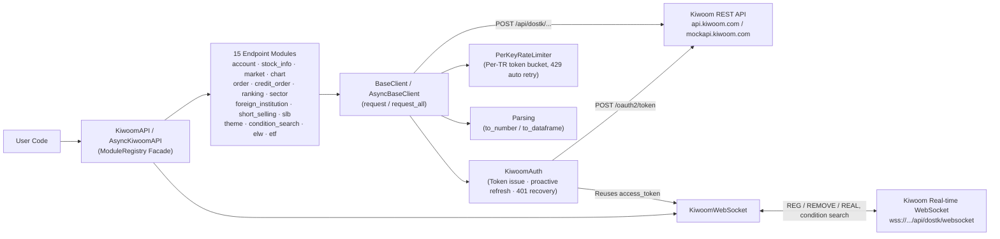
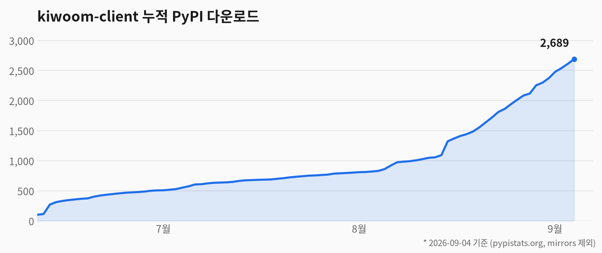

[한국어](README.md) | [English](README_EN.md)

# kiwoom-client — Python client for the Kiwoom Securities REST API

The whole Kiwoom REST API in one Python client: 182 endpoints, real-time WebSocket, and an MCP server so AI agents can trade Korean stocks too. No COM/OCX, so it runs on Windows, macOS and Linux.

[](https://pypi.org/project/kiwoom-client/)
[](https://pypi.org/project/kiwoom-client/)
[](https://pepy.tech/project/kiwoom-client)
[](https://github.com/younghwan91/kiwoom-client/actions/workflows/ci.yml)
[](https://github.com/younghwan91/kiwoom-client/blob/main/LICENSE)
[](https://pypi.org/project/kiwoom-client/)
[](https://www.linkedin.com/in/younghwan-chae/)

- **182 REST endpoints + 4 condition-search calls + 19 real-time types** across 15 modules. The figure below is counted from the code: one tile, one endpoint.
- **MCP server built in**: Claude Code and Cursor call quotes, account and orders through tools like `stock_info_basic_stock_info`. Against a live account the order tools are **not even registered** until you set `KIWOOM_MCP_ALLOW_LIVE_ORDERS=true`.
- **Bots don't die on an expired token**: refreshed before expiry, reissued on 401. A per-TR rate limiter keeps you under the 429 line and backs off and retries if one slips through.

<picture>
  <source media="(prefers-color-scheme: dark)" srcset="docs/images/hero-dark.png">
  
</picture>

## Quick start

```bash
pip install kiwoom-client
```

```python
from kiwoom_client import KiwoomAPI

api = KiwoomAPI(app_key="YOUR_APP_KEY", app_secret="YOUR_APP_SECRET", is_mock=True)  # True = mock trading

info = api.stock_info.basic_stock_info(stk_cd="005930")                   # Samsung Electronics
chart = api.chart.stock_daily_chart(stk_cd="005930", base_dt="20260326")  # daily chart
print(info["stk_nm"])
```

No login step: the access token is issued on the first call and refreshed before it expires.
Get an app key/secret at the [Kiwoom REST API portal](https://openapi.kiwoom.com) and start on the mock server (`is_mock=True`).
Using it from an AI agent? Jump to [MCP server](#using-as-an-mcp-server).

## What it does

- **Cross-platform**: REST-based, so it runs on Windows, macOS, Linux and headless servers. No COM/OCX.
- **Sync and async**: `KiwoomAPI` and `AsyncKiwoomAPI` expose the same endpoints.
- **Auto token management**: issue, proactive refresh and 401 reissue are handled for you.
- **Built-in rate limiter**: per-TR (api_id) token bucket (1 req/s, burst 2) with automatic retry on 429.
- **Auto pagination**: `request_all()` follows `cont-yn`/`next-key` to the last page.
- **Usable responses**: `to_dataframe()` turns `"+70000"`-style strings into numbers and hands you a DataFrame.
- **Tick-size snapping**: `round_to_tick()` makes limit prices valid KRX ticks.
- **Real-time WebSocket**: 19 subscription types with PING, reconnect and re-subscribe handled. Condition search rides the same socket.
- **MCP server**: every REST endpoint in the 15 modules plus the 4 condition-search calls, exposed as MCP tools.

Unlike the legacy Kiwoom OpenAPI+ (OCX/COM) or `pykiwoom`, there is no 32-bit/Windows-only constraint, no GUI dependency, and installation is one `pip install`.

## Installation and prerequisites

```bash
pip install kiwoom-client            # base
pip install 'kiwoom-client[pandas]'  # adds to_dataframe()
pip install 'kiwoom-client[mcp]'     # adds the MCP server
uv add kiwoom-client                 # if you use uv
```

- Python **3.10+**.
- Apply for API access at the [Kiwoom REST API portal](https://openapi.kiwoom.com) to get your `app_key` and `app_secret`. See [`.env.example`](.env.example) for environment variables.
- Mock and live keys are different pairs. Authentication fails if `is_mock` doesn't match the key.

| | Live | Mock |
|---|---|---|
| `is_mock` | `False` (default) | `True` |
| REST URL | `https://api.kiwoom.com` | `https://mockapi.kiwoom.com` |
| WebSocket URL | `wss://api.kiwoom.com:10000` | `wss://mockapi.kiwoom.com:10000` |

## Usage

### Account and orders

```python
evaluation = api.account.account_evaluation()   # account valuation
deposit = api.account.deposit_detail()          # cash balance
position = api.account.filled_position()        # holdings
unfilled = api.account.unfilled_orders()        # open orders

# Buy 10 shares of Samsung Electronics at limit
result = api.order.buy_order(
    dmst_stex_tp="01",   # exchange (01: KRX)
    stk_cd="005930",
    ord_qty=10,
    trde_tp="00",        # order type (00: limit)
    ord_uv=70000,        # price
)
api.order.sell_order(dmst_stex_tp="01", stk_cd="005930", ord_qty=10, trde_tp="00", ord_uv=75000)
api.order.modify_order(org_ord_no="ORIGINAL_ORDER_NO", ord_qty=5, ord_uv=71000)
api.order.cancel_order(org_ord_no="ORIGINAL_ORDER_NO", ord_qty=5)

api.logout()  # revoke the token (optional)
api.close()   # automatic inside a `with` block
```

Limit prices (`ord_uv`) must be multiples of the KRX tick size, or the exchange rejects them or fills at an unintended price:

```python
from kiwoom_client import round_to_tick, tick_size

tick_size(70123)        # Decimal('100')   (KRW 50k–200k bracket has 100 KRW tick size)
round_to_tick(70123)    # Decimal('70100') (snaps down to previous valid tick)

api.order.buy_order(
    dmst_stex_tp="01", stk_cd="005930", ord_qty=10,
    trde_tp="00", ord_uv=round_to_tick(target_price),
)
```

### Asyncio

`AsyncKiwoomAPI` exposes the same endpoints; just `await` the calls. Different TRs run concurrently, and the per-TR limiter only serializes repeated calls to the same TR.

```python
import asyncio
from kiwoom_client import AsyncKiwoomAPI

async def main():
    async with AsyncKiwoomAPI(app_key="...", app_secret="...", is_mock=True) as api:
        info, chart = await asyncio.gather(
            api.stock_info.basic_stock_info(stk_cd="005930"),
            api.chart.stock_daily_chart(stk_cd="005930", base_dt="20260326"),
        )
        print(info["stk_nm"])

asyncio.run(main())
```

Full example: [`examples/async_usage.py`](examples/async_usage.py).

### Working with responses

Kiwoom returns every field as a string: a price as `"+70000"`, a volume as `"1,234,567"`.

```python
from kiwoom_client import to_dataframe, to_number, normalize

df = to_dataframe(api.ranking.top_volume_today(...))  # payload key found for you
print(df["cur_prc"].mean())

data = normalize(result)      # same conversion, still a dict
price = to_number("+70000")   # 70000
```

Stock codes (`"005930"`) and date fields stay strings. `to_dataframe()` needs pandas (`pip install 'kiwoom-client[pandas]'`).

### Real-time WebSocket

```python
import asyncio
from kiwoom_client import KiwoomAPI

api = KiwoomAPI(app_key="YOUR_KEY", app_secret="YOUR_SECRET")
ws = api.create_websocket()

async def main():
    await ws.connect()  # includes the LOGIN handshake

    # Callbacks get one entry of the REAL frame:
    # {"type": "0B", "item": "005930", "values": {"10": "+70000", ...}}
    ws.on("0B", lambda d: print(f"Trade {d['item']}: {d['values'].get('10')}"))

    await ws.subscribe("0B", ["005930", "000660"])
    await ws.listen()  # answers PING, reconnects and re-subscribes on drop

asyncio.run(main())
```

`values` keys are Kiwoom FID numbers (10 = current price, 13 = cumulative volume).

Condition search rides the same socket:

```python
ws.on_trnm("CNSRLST", lambda d: print(d["data"]))
await ws.send(api.condition_search.condition_list())
await ws.send(api.condition_search.condition_search_realtime(seq="1"))
```

> **Verification status**: the LOGIN handshake, PING frame and REG acknowledgement are
> confirmed against the live server (api.kiwoom.com). The REAL frame's per-item field
> names (`item`/`values`) are still unconfirmed, since the market was closed during testing.
> Run `python tests/integration_ws_smoke.py --prod` to check for yourself.

### Pagination (`request_all`)

Endpoints with large result sets return paginated data (`cont-yn="Y"`). `request_all()` fetches every page:

```python
all_data = api._client.request_all(
    "/api/dostk/acnt", "ka10076",
    data_key="filled_list",  # key name of list items in response
)
```

### Rate limiting (measured)

Kiwoom enforces **independent per-TR (api_id)** rate limits:

| Metric | Measured |
|---|---|
| Sustained safe throughput | **~1 req/s per TR** (0 rejections at this rate) |
| Burst allowance | **~2 requests per TR** |
| Rejection response | HTTP `429` + `{"return_code": 5, "return_msg": "허용된 요청 개수를 초과하였습니다"}` |
| Scope | **Per-TR independent**: different TRs do not throttle each other |

The library ships a **per-TR token-bucket limiter (1 req/s, burst 2)** with **backoff and retry on 429**:

```python
api = KiwoomAPI(app_key="...", app_secret="...")                                               # defaults
api = KiwoomAPI(app_key="...", app_secret="...", rate_limit=2.0, rate_burst=3, max_retries=5)  # custom
api = KiwoomAPI(app_key="...", app_secret="...", rate_limit=None)                              # no client-side throttle
```

### Error handling

```python
from kiwoom_client.base import KiwoomAPIError

try:
    result = api.order.buy_order(stk_cd="005930", ord_qty=10, ord_uv=70000)
except KiwoomAPIError as e:
    print(f"Code: {e.code}, Message: {e.message}")
```

## Using as an MCP server

Call this library directly from MCP (Model Context Protocol) clients such as Claude Code and Cursor. Every REST endpoint across all 15 modules, plus the 4 condition-search calls, is exposed as an MCP tool.

```bash
pip install 'kiwoom-client[mcp]'
```

Add to your MCP client config (e.g. Claude Code `.mcp.json`):

```json
{
  "mcpServers": {
    "kiwoom-client": {
      "command": "kiwoom-client-mcp",
      "env": {
        "KIWOOM_APP_KEY": "your_app_key",
        "KIWOOM_APP_SECRET": "your_app_secret",
        "KIWOOM_IS_MOCK": "true"
      }
    }
  }
}
```

| Env var | Description | Default |
|---|---|---|
| `KIWOOM_APP_KEY` | App key (required) | — |
| `KIWOOM_APP_SECRET` | App secret (required) | — |
| `KIWOOM_IS_MOCK` | Use the mock trading server | `false` |
| `KIWOOM_MCP_ALLOW_LIVE_ORDERS` | Expose order tools (buy/sell/modify/cancel, credit orders) against a live account | `false` |

**Live-order guard**: when `KIWOOM_IS_MOCK=false` (live account) and `KIWOOM_MCP_ALLOW_LIVE_ORDERS` is not `true`, order-related tools are not registered at server startup at all; the AI agent never sees they exist. Mock trading (`KIWOOM_IS_MOCK=true`) always has them available. The guard applies only to the MCP path; direct use of `KiwoomAPI`/`AsyncKiwoomAPI` from Python is unaffected.

Query-style tools take `{"params": {...}}`, passed straight through as the TR request body (field names in the [Kiwoom REST API guide](https://openapi.kiwoom.com)). Example: `stock_info_basic_stock_info` with `{"params": {"stk_cd": "005930"}}`.

## Architecture

`KiwoomAPI` (sync) and `AsyncKiwoomAPI` (async) share the same facade. `ModuleRegistry` lazily creates the 15 endpoint modules; HTTP, auth and retries live in `BaseClient`/`AsyncBaseClient`; `KiwoomWebSocket` reuses the same token for real-time data.



## API categories

| Category | Module | Endpoints |
|----------|--------|-----------|
| Account | `api.account` | 33 |
| Stock Info | `api.stock_info` | 31 |
| Market Data | `api.market` | 25 |
| Rankings | `api.ranking` | 23 |
| Charts | `api.chart` | 21 |
| ELW | `api.elw` | 11 |
| ETF | `api.etf` | 9 |
| Orders | `api.order` | 8 |
| Sectors | `api.sector` | 6 |
| Credit Orders | `api.credit_order` | 4 |
| Foreign/Institutional | `api.foreign_institution` | 4 |
| Stock Lending (SLB) | `api.slb` | 4 |
| Condition Search | `api.condition_search` | 4 |
| Themes | `api.theme` | 2 |
| Short Selling | `api.short_selling` | 1 |
| Real-time WebSocket | `api.create_websocket()` | 19 types |

Method names and parameters: [`src/kiwoom_client/domestic/`](src/kiwoom_client/domestic/) or your IDE's autocomplete. API IDs (`ka10001` etc.) match the TR codes in Kiwoom's official guide.

## FAQ

**Sync (`KiwoomAPI`) or async (`AsyncKiwoomAPI`)?**
Sync is fine for one-off scripts. Reach for async when you're fetching multiple symbols concurrently or combining REST calls with the real-time WebSocket.

**I keep getting an "invalid token" error.**
Expired tokens are refreshed and retried automatically. If it persists, check that `is_mock` matches the app key/secret you're using. A mock-trading key won't authenticate against the live server, and vice versa.

**I keep hitting HTTP `429`.**
The built-in limiter (1 req/s per TR, burst of 2) can still be exceeded if multiple processes or threads hit the same TR concurrently. Lower `rate_limit` or coordinate calls from one place. See [Rate limiting](#rate-limiting-measured).

**My limit order (`buy_order`/`sell_order`) gets rejected.**
`ord_uv` must be a multiple of the KRX tick size. Snap it with [`round_to_tick()`](#account-and-orders).

**Do I need pandas?**
Only for `to_dataframe()`. The base install returns plain dicts/lists.

More questions? Open an [issue](https://github.com/younghwan91/kiwoom-client/issues).

## Where it runs

The daily collection DAGs in [quant-airflow](https://github.com/younghwan91/quant-airflow) use this library to load prices, supply/demand, margin and short-sale data into TimescaleDB every day. The rest of the stack is [below](#related-projects--open-source-quant-stack).

<picture>
  <source media="(prefers-color-scheme: dark)" srcset="docs/images/pypi_downloads_dark.png">
  
</picture>

## Contributing & issues

- 🐛 Bugs & feature requests → [Issues](https://github.com/younghwan91/kiwoom-client/issues)
- 🔧 Pull requests welcome → See [CONTRIBUTING.md](CONTRIBUTING.md) for guidelines and dev setup.

## License

MIT

## Related projects — open-source quant stack

Part of an open-source stack spanning Korean equities, US equities and crypto. Each repository stands on its own.

| Market | Project | What it is |
|---|---|---|
| 🇰🇷 Korean equities | **[krx-fundamentals-client](https://github.com/younghwan91/krx-fundamentals-client)** | Korean corporate fundamentals Python client library — financial statements, valuation, dividends, screening (DART + KRX + Naver) |
| 🇰🇷 Korean equities | **[krx-news-client](https://github.com/younghwan91/krx-news-client)** | Korean market news & disclosures as one schema — Python client library (DART + Toss Securities) |
| 🇰🇷 Korean equities | **[krx-quant-core](https://github.com/younghwan91/krx-quant-core)** | Shared Python core for Korean-equity quant systems — KRX tick, price-limit and session rules, date-aware transaction-tax cost model, Kiwoom order guards, DART material-disclosure risk classification, fill simulation, Deflated Sharpe and purged CV stats |
| 🇰🇷 Korean equities | **[fin-checkup](https://github.com/younghwan91/fin-checkup)** | Telegram alerts for risk disclosures + a DART/SEC financial health checkup — reports measurements and facts, never a recommendation |
| 🇰🇷 Korean equities | **[quant-airflow](https://github.com/younghwan91/quant-airflow)** | Airflow pipeline collecting Korean market data into TimescaleDB — delisted names included, so downstream backtests aren't survivorship-biased |
| 🇰🇷 Korean equities | **[swing-it](https://github.com/younghwan91/swing-it)** | KOSPI/KOSDAQ alpha validation framework — judged on the per-trade distribution, with random null controls, purged CV and Deflated Sharpe enforced as CI guardrails |
| 🇺🇸 US equities | **[portfolio-research](https://github.com/younghwan91/portfolio-research)** | US equity factor engine — walk-forward gated by Deflated Sharpe and PBO on point-in-time, survivorship-bias-free data; tactical ETF allocation goes through the same gate |
| 🇺🇸 US equities | **[macro-sector-agent](https://github.com/younghwan91/macro-sector-agent)** | Top-down US sector-cycle research — asks which industry has been forgotten, not what to buy; the machine excludes, never picks |
| 🇺🇸 US equities | **[automated-stock-trading-systems](https://github.com/younghwan91/automated-stock-trading-systems)** | Backtester for Bensdorp's seven non-correlated trading systems (educational reimplementation) |
| ₿ Crypto | **[binance-quant-engine](https://github.com/younghwan91/binance-quant-engine)** | Crypto futures backtest & execution engine — zero lookahead, backtest↔live parity |
| ₿ Crypto | **[crypto-quant-insights](https://github.com/younghwan91/crypto-quant-insights)** | Chart-backed research notes from validating a live futures system — crash stress tests, Kelly leverage, live/backtest execution gaps |

## Author

**Younghwan Chae** · [GitHub @younghwan91](https://github.com/younghwan91) · [LinkedIn](https://www.linkedin.com/in/younghwan-chae/)

See the full open-source quant stack on my [profile](https://github.com/younghwan91).
