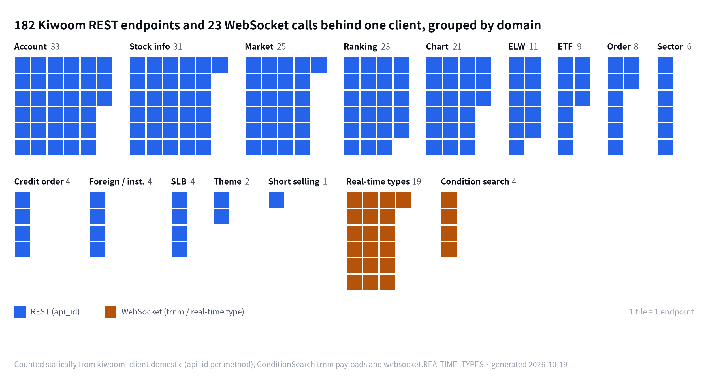
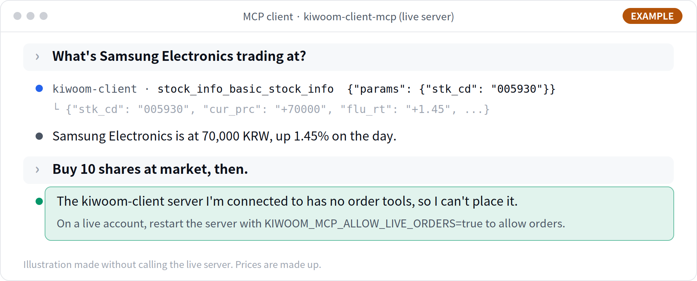
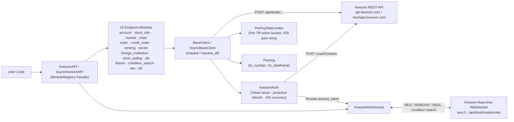
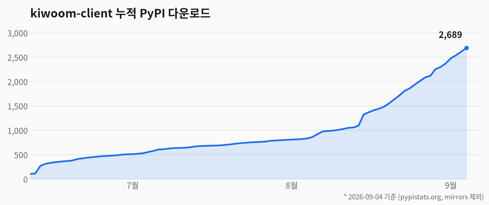

[한국어](https://github.com/younghwan91/kiwoom-client/blob/main/README.md) | [English](https://github.com/younghwan91/kiwoom-client/blob/main/README_EN.md)

<picture>
  <source media="(prefers-color-scheme: dark)" srcset="https://raw.githubusercontent.com/younghwan91/kiwoom-client/main/docs/images/brand/wordmark-dark.svg">
  
</picture>

# kiwoom-client — Python client for the Kiwoom Securities REST API

**The Kiwoom REST API, from Python and AI agents.** 182 endpoints, real-time WebSocket, and an MCP server so AI agents can trade Korean stocks too. No OpenAPI+ COM/OCX, so trading bots and data jobs run on Windows, macOS and Linux. An unofficial open-source project, not affiliated with Kiwoom Securities.

[](https://pypi.org/project/kiwoom-client/)
[](https://pypi.org/project/kiwoom-client/)
[](https://pypi.org/project/kiwoom-client/)
[](https://github.com/younghwan91/kiwoom-client/actions/workflows/ci.yml)
[](https://github.com/younghwan91/kiwoom-client/blob/main/LICENSE)
[](https://younghwan91.github.io/kiwoom-client/en/)

- **182 REST endpoints + 4 condition-search calls + 19 real-time types** across 15 modules. The figure below is counted from the code: one tile, one endpoint.
- **MCP server built in**: Claude Code and Cursor call quotes, account and orders through tools like `stock_info_basic_stock_info`. Against a live account the order tools are **not even registered** until you set `KIWOOM_MCP_ALLOW_LIVE_ORDERS=true`.
- **Bots don't die on an expired token**: refreshed before expiry, reissued on 401. A per-TR rate limiter keeps you under the 429 line and backs off and retries if one slips through.

<picture>
  <source media="(prefers-color-scheme: dark)" srcset="https://raw.githubusercontent.com/younghwan91/kiwoom-client/main/docs/images/hero-dark.png">
  
</picture>

## Quick start

```bash
pip install kiwoom-client
```

```python
from kiwoom_client import KiwoomAPI

api = KiwoomAPI.from_env(is_mock=True)  # KIWOOM_APP_KEY / KIWOOM_APP_SECRET env vars (or from_env(".env"))
# or explicitly: KiwoomAPI(app_key="YOUR_APP_KEY", app_secret="YOUR_APP_SECRET", is_mock=True)

info = api.stock_info.basic_stock_info(stk_cd=api.stock_code("삼성전자"))  # name -> 005930
chart = api.chart.stock_daily_chart(stk_cd="005930", base_dt="20260326", upd_stkpc_tp="1")  # daily chart
print(info["stk_nm"])
```

No login step: the access token is issued on the first call and refreshed before it expires.
Get an app key/secret at the [Kiwoom REST API portal](https://openapi.kiwoom.com) and start on the mock server (`is_mock=True`).

### From an AI agent (MCP)

```bash
pip install 'kiwoom-client[mcp]'
claude mcp add --transport stdio \
  --env KIWOOM_APP_KEY=YOUR_APP_KEY --env KIWOOM_APP_SECRET=YOUR_APP_SECRET --env KIWOOM_IS_MOCK=true \
  kiwoom-client -- kiwoom-client-mcp
```

Now ask Claude Code "What's Samsung Electronics trading at?". Other clients such as Cursor, and the environment variables, are in [Using as an MCP server](#using-as-an-mcp-server).

<picture>
  <source media="(prefers-color-scheme: dark)" srcset="https://raw.githubusercontent.com/younghwan91/kiwoom-client/main/docs/images/demo-mcp-en-dark.png">
  
</picture>

<sub>Illustration made without calling the live server (prices are made up). On a live account the order tools are not registered until `KIWOOM_MCP_ALLOW_LIVE_ORDERS=true`, so the agent has no way to place an order.</sub>

Further reading: [Why kiwoom-client — compared with OpenAPI+, pykiwoom and other REST wrappers](https://younghwan91.github.io/kiwoom-client/en/why/) · [Endpoint reference](https://younghwan91.github.io/kiwoom-client/en/endpoints/)

## What it does

- **Cross-platform**: REST-based, so it runs on Windows, macOS, Linux and headless servers. No COM/OCX.
- **Sync and async**: `KiwoomAPI` and `AsyncKiwoomAPI` expose the same endpoints.
- **Auto token management**: issue, proactive refresh and 401 reissue are handled for you.
- **Built-in rate limiter**: per-TR (api_id) token bucket (1 req/s, burst 2) with automatic retry on 429.
- **Auto pagination**: `request_all()` follows `cont-yn`/`next-key` to the last page.
- **Usable responses**: `to_dataframe()` turns `"+70000"`-style strings into numbers and hands you a DataFrame.
- **Tick-size snapping**: `round_to_tick()` makes limit prices valid KRX ticks.
- **Real-time WebSocket**: 19 subscription types with PING, reconnect and re-subscribe handled. Condition search rides the same socket.
- **MCP server**: every REST endpoint in the 15 modules plus the 4 condition-search calls, exposed as MCP tools.

Unlike the legacy Kiwoom OpenAPI+ (OCX/COM) or `pykiwoom`, there is no 32-bit/Windows-only constraint, no GUI dependency, and installation is one `pip install`.
For a comparison that includes Kiwoom's official repository and other REST wrappers, see [Why kiwoom-client](https://younghwan91.github.io/kiwoom-client/en/why/); to port OpenAPI+ code, see the [migration table](https://younghwan91.github.io/kiwoom-client/en/migration-from-openapi-plus/).

## Installation and prerequisites

```bash
pip install kiwoom-client            # base
pip install 'kiwoom-client[pandas]'  # adds to_dataframe()
pip install 'kiwoom-client[mcp]'     # adds the MCP server
uv add kiwoom-client                 # if you use uv
```

- Python **3.10+**.
- Apply for API access at the [Kiwoom REST API portal](https://openapi.kiwoom.com) to get your `app_key` and `app_secret`. See [`.env.example`](https://github.com/younghwan91/kiwoom-client/blob/main/.env.example) for environment variables.
- Mock and live keys are different pairs. Authentication fails if `is_mock` doesn't match the key.

| | Live | Mock |
|---|---|---|
| `is_mock` | `False` (default) | `True` |
| REST URL | `https://api.kiwoom.com` | `https://mockapi.kiwoom.com` |
| WebSocket URL | `wss://api.kiwoom.com:10000` | `wss://mockapi.kiwoom.com:10000` |

## Usage

### Account and orders

```python
evaluation = api.account.account_evaluation(qry_tp="0", dmst_stex_tp="KRX")  # account valuation
deposit = api.account.deposit_detail(qry_tp="3")  # cash balance
position = api.account.filled_position(dmst_stex_tp="KRX")  # holdings
unfilled = api.account.unfilled_orders(all_stk_tp="0", trde_tp="0", stex_tp="0")  # open orders

# Buy 10 shares of Samsung Electronics at limit
result = api.order.buy_order(   # values per Kiwoom's official spec (strings)
    dmst_stex_tp="KRX",  # exchange: KRX / NXT / SOR
    stk_cd="005930",
    ord_qty="10",
    ord_uv="70000",      # price
    trde_tp="0",         # 0 regular (limit), 3 market, 28 stop-limit ...
)
api.order.sell_order(dmst_stex_tp="KRX", stk_cd="005930", ord_qty="10", ord_uv="75000", trde_tp="0")
api.order.modify_order(   # modify (kt10002)
    dmst_stex_tp="KRX", orig_ord_no="ORIGINAL_ORDER_NO", stk_cd="005930", mdfy_qty="5", mdfy_uv="71000",
)
api.order.cancel_order(   # cancel (kt10003) -- cncl_qty="0" cancels the whole remainder
    dmst_stex_tp="KRX", orig_ord_no="ORIGINAL_ORDER_NO", stk_cd="005930", cncl_qty="5",
)

api.logout()  # revoke the token (optional)
api.close()   # automatic inside a `with` block
```

Limit prices (`ord_uv`) must be multiples of the KRX tick size, or the exchange rejects them or fills at an unintended price:

```python
from kiwoom_client import add_ticks, round_to_tick, tick_size

tick_size(70123)        # Decimal('100')   (KRW 50k–200k bracket has 100 KRW tick size)
round_to_tick(70123)    # Decimal('70100') (snaps down to previous valid tick)
add_ticks(49950, 2)     # Decimal('50100') (N ticks across a band edge)

api.order.buy_order(
    dmst_stex_tp="KRX", stk_cd="005930", ord_qty="10",
    ord_uv=str(round_to_tick(target_price)), trde_tp="0",
)
```

### Asyncio

`AsyncKiwoomAPI` exposes the same endpoints; just `await` the calls. Different TRs run concurrently, and the per-TR limiter only serializes repeated calls to the same TR.

```python
import asyncio
from kiwoom_client import AsyncKiwoomAPI

async def main():
    async with AsyncKiwoomAPI(app_key="...", app_secret="...", is_mock=True) as api:
        info, chart = await asyncio.gather(
            api.stock_info.basic_stock_info(stk_cd="005930"),
            api.chart.stock_daily_chart(stk_cd="005930", base_dt="20260326", upd_stkpc_tp="1"),
        )
        print(info["stk_nm"])

asyncio.run(main())
```

Full example: [`examples/async_usage.py`](https://github.com/younghwan91/kiwoom-client/blob/main/examples/async_usage.py).

### Working with responses

Kiwoom returns every field as a string: a price as `"+70000"`, a volume as `"1,234,567"`.

```python
from kiwoom_client import to_dataframe, to_number, normalize

df = to_dataframe(api.ranking.top_volume_today(...))  # payload key found for you
print(df["cur_prc"].mean())

data = normalize(result)      # same conversion, still a dict
price = to_number("+70000")   # 70000
```

Stock codes (`"005930"`) and date fields stay strings. `to_dataframe()` needs pandas (`pip install 'kiwoom-client[pandas]'`).
For chart responses, `to_ohlcv(resp)` gives an `open/high/low/close/volume` DataFrame indexed by date.

### Real-time WebSocket

```python
import asyncio
from kiwoom_client import KiwoomAPI

api = KiwoomAPI(app_key="YOUR_KEY", app_secret="YOUR_SECRET")
ws = api.create_websocket()

async def main():
    await ws.connect()  # includes the LOGIN handshake

    # Callbacks get one entry of the REAL frame:
    # {"type": "0B", "item": "005930", "values": {"10": "+70000", ...}}
    ws.on("0B", lambda d: print(f"Trade {d['item']}: {d['values'].get('10')}"))

    await ws.subscribe("0B", ["005930", "000660"])
    await ws.listen()  # answers PING, reconnects and re-subscribes on drop

asyncio.run(main())
```

`values` keys are Kiwoom FID numbers (10 = current price, 13 = cumulative volume).

Condition search rides the same socket:

```python
ws.on_trnm("CNSRLST", lambda d: print(d["data"]))
await ws.send(api.condition_search.condition_list())
await ws.send(api.condition_search.condition_search_realtime(seq="1"))
```

> **Verification status**: the LOGIN handshake, PING frame and REG acknowledgement are
> confirmed against the live server (api.kiwoom.com). The REAL frame's per-item field
> names (`item`/`values`) are still unconfirmed, since the market was closed during testing.
> Run `python tests/integration_ws_smoke.py --prod` to check for yourself.

### Pagination (`request_all`)

Endpoints with large result sets return paginated data (`cont-yn="Y"`). `request_all()` fetches every page:

```python
all_data = api._client.request_all(
    "/api/dostk/acnt", "ka10076",
    data_key="filled_list",  # key name of list items in response
)
```

### Rate limiting (measured)

Kiwoom enforces **independent per-TR (api_id)** rate limits:

| Metric | Measured |
|---|---|
| Sustained safe throughput | **~1 req/s per TR** (0 rejections at this rate) |
| Burst allowance | **~2 requests per TR** |
| Rejection response | HTTP `429` + `{"return_code": 5, "return_msg": "허용된 요청 개수를 초과하였습니다"}` |
| Scope | **Per-TR independent**: different TRs do not throttle each other |

The library ships a **per-TR token-bucket limiter (1 req/s, burst 2)** with **backoff and retry on 429**:

```python
api = KiwoomAPI(app_key="...", app_secret="...")                                               # defaults
api = KiwoomAPI(app_key="...", app_secret="...", rate_limit=2.0, rate_burst=3, max_retries=5)  # custom
api = KiwoomAPI(app_key="...", app_secret="...", rate_limit=None)                              # no client-side throttle
```

### Error handling

```python
from kiwoom_client.base import KiwoomAPIError

try:
    result = api.order.buy_order(
        dmst_stex_tp="KRX", stk_cd="005930", ord_qty="10", ord_uv="70000", trde_tp="0",
    )
except KiwoomAPIError as e:
    print(f"Code: {e.code}, Message: {e.message}")
```

Narrower subclasses — `KiwoomTokenError`, `KiwoomServerMismatchError` (mock/live key mismatch), `KiwoomRateLimitError`, … —
are all `KiwoomAPIError`, so the block above still catches them. Known causes carry a next step in `e.hint`.

### Conveniences

Stock search by name (`api.find_stock`), named codes (`OrderType.LIMIT`, `Exchange.KRX`), a read-only CLI
(`kiwoom quote 005930 --mock`), masked `repr`, DEBUG request tracing and `timeout=` are covered in
[the convenience docs](https://younghwan91.github.io/kiwoom-client/en/convenience/) (Korean).

## Using as an MCP server

MCP clients such as Claude Code, Claude Desktop, Cursor and Codex call this library as tools. Every REST endpoint across all 15 modules, the 4 condition-search calls, and helper tools (`stock_search` name→code, `stock_snapshot`, `account_summary`, and `order_preview`, which never sends) are exposed.

```bash
uvx --from 'kiwoom-client[mcp]' kiwoom-client-mcp config claude-code   # prints a snippet to paste (also claude-desktop, cursor, codex)
```

| Env var | Description | Default |
|---|---|---|
| `KIWOOM_APP_KEY` / `KIWOOM_APP_SECRET` | App key and secret (required) | — |
| `KIWOOM_IS_MOCK` | Use the mock trading server (true/false) | `false` |
| `KIWOOM_MCP_TOOLSETS` | Modules to expose (e.g. `market,chart,account`) | all |
| `KIWOOM_MCP_MODE` | `discovery` exposes only three meta tools to save context | — |
| `KIWOOM_MCP_ALLOW_LIVE_ORDERS` | Expose order tools against a live account | `false` |

**Live-order guard**: when `KIWOOM_IS_MOCK=false` (live account) and `KIWOOM_MCP_ALLOW_LIVE_ORDERS` is not `true`, order-related tools are not registered at server startup at all. No path (tool list, toolset filter, discovery mode) lets the agent reach them. Mock trading (`KIWOOM_IS_MOCK=true`) always has them available. The guard applies only to the MCP path; direct use of `KiwoomAPI`/`AsyncKiwoomAPI` from Python is unaffected.

Per-client setup, every option (`--toolsets`, `--discovery`, `--max-rows`), tools, resources, prompts and troubleshooting are in the [MCP server docs](https://younghwan91.github.io/kiwoom-client/en/mcp/).

## Architecture

`KiwoomAPI` (sync) and `AsyncKiwoomAPI` (async) share the same facade. `ModuleRegistry` lazily creates the 15 endpoint modules; HTTP, auth and retries live in `BaseClient`/`AsyncBaseClient`; `KiwoomWebSocket` reuses the same token for real-time data.



## API categories

| Category | Module | Endpoints |
|----------|--------|-----------|
| Account | `api.account` | 33 |
| Stock Info | `api.stock_info` | 31 |
| Market Data | `api.market` | 25 |
| Rankings | `api.ranking` | 23 |
| Charts | `api.chart` | 21 |
| ELW | `api.elw` | 11 |
| ETF | `api.etf` | 9 |
| Orders | `api.order` | 8 |
| Sectors | `api.sector` | 6 |
| Credit Orders | `api.credit_order` | 4 |
| Foreign/Institutional | `api.foreign_institution` | 4 |
| Stock Lending (SLB) | `api.slb` | 4 |
| Condition Search | `api.condition_search` | 4 |
| Themes | `api.theme` | 2 |
| Short Selling | `api.short_selling` | 1 |
| Real-time WebSocket | `api.create_websocket()` | 19 types |

Every method with its api_id and Korean/English TR name: [the endpoint list](https://younghwan91.github.io/kiwoom-client/en/endpoints/) (generated from the code). API IDs (`ka10001` etc.) match the TR codes in Kiwoom's official guide.

## FAQ

**Sync (`KiwoomAPI`) or async (`AsyncKiwoomAPI`)?**
Sync is fine for one-off scripts. Reach for async when you're fetching multiple symbols concurrently or combining REST calls with the real-time WebSocket.

**I keep getting an "invalid token" error.**
Expired tokens are refreshed and retried automatically. If it persists, check that `is_mock` matches the app key/secret you're using. A mock-trading key won't authenticate against the live server, and vice versa.

**I keep hitting HTTP `429`.**
The built-in limiter (1 req/s per TR, burst of 2) can still be exceeded if multiple processes or threads hit the same TR concurrently. Lower `rate_limit` or coordinate calls from one place. See [Rate limiting](#rate-limiting-measured).

**My limit order (`buy_order`/`sell_order`) gets rejected.**
`ord_uv` must be a multiple of the KRX tick size. Snap it with [`round_to_tick()`](#account-and-orders).

**Do I need pandas?**
Only for `to_dataframe()`. The base install returns plain dicts/lists.

More in the [FAQ](https://younghwan91.github.io/kiwoom-client/en/faq/) and, by error code, in [Troubleshooting](https://younghwan91.github.io/kiwoom-client/en/troubleshooting/). Still stuck? Open an [issue](https://github.com/younghwan91/kiwoom-client/issues).

## Where it runs

The daily collection DAGs in [quant-airflow](https://github.com/younghwan91/quant-airflow) use this library to load prices, supply/demand, margin and short-sale data into TimescaleDB every day.

<picture>
  <source media="(prefers-color-scheme: dark)" srcset="https://raw.githubusercontent.com/younghwan91/kiwoom-client/main/docs/images/pypi_downloads_dark.png">
  
</picture>

## Contributing & issues

- 🐛 Bugs & feature requests → [Issues](https://github.com/younghwan91/kiwoom-client/issues)
- 🔧 Pull requests welcome → See [CONTRIBUTING.md](https://github.com/younghwan91/kiwoom-client/blob/main/CONTRIBUTING.md) for guidelines and dev setup.

## License

MIT

kiwoom-client is an **unofficial open-source project, not affiliated with or endorsed by Kiwoom Securities**. "Kiwoom" is a trademark of Kiwoom Securities Co., Ltd.; this project is only a client for its public REST API.

## Author

**Younghwan Chae** · [GitHub @younghwan91](https://github.com/younghwan91) · [LinkedIn](https://www.linkedin.com/in/younghwan-chae/)

See the full open-source quant stack on my [profile](https://github.com/younghwan91).
