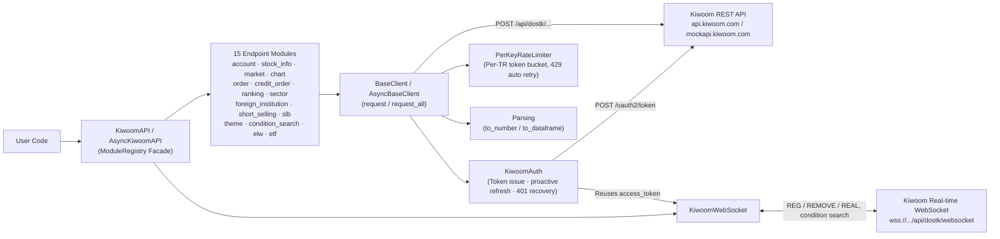

# Usage Guide

New here? Start with the [README](https://github.com/younghwan91/kiwoom-client/blob/main/README.en.md).

<!-- toc -->
- [Usage](#usage)
- [Using as an MCP server](#using-as-an-mcp-server)
- [Architecture](#architecture)
- [API categories](#api-categories)
- [FAQ](#faq)
<!-- /toc -->

## Usage

### Account and orders

```python
evaluation = api.account.account_evaluation(qry_tp="0", dmst_stex_tp="KRX")  # account valuation
deposit = api.account.deposit_detail(qry_tp="3")  # cash balance
position = api.account.filled_position(dmst_stex_tp="KRX")  # holdings
unfilled = api.account.unfilled_orders(all_stk_tp="0", trde_tp="0", stex_tp="0")  # open orders

# Buy 10 shares of Samsung Electronics at limit
result = api.order.buy_order(   # values per Kiwoom's official spec (strings)
    dmst_stex_tp="KRX",  # exchange: KRX / NXT / SOR
    stk_cd="005930",
    ord_qty="10",
    ord_uv="70000",      # price
    trde_tp="0",         # 0 regular (limit), 3 market, 28 stop-limit ...
)
api.order.sell_order(dmst_stex_tp="KRX", stk_cd="005930", ord_qty="10", ord_uv="75000", trde_tp="0")
api.order.modify_order(   # modify (kt10002)
    dmst_stex_tp="KRX", orig_ord_no="ORIGINAL_ORDER_NO", stk_cd="005930", mdfy_qty="5", mdfy_uv="71000",
)
api.order.cancel_order(   # cancel (kt10003) -- cncl_qty="0" cancels the whole remainder
    dmst_stex_tp="KRX", orig_ord_no="ORIGINAL_ORDER_NO", stk_cd="005930", cncl_qty="5",
)

api.logout()  # revoke the token (optional)
api.close()   # automatic inside a `with` block
```

Limit prices (`ord_uv`) must be multiples of the KRX tick size, or the exchange rejects them or fills at an unintended price:

```python
from kiwoom_client import add_ticks, round_to_tick, tick_size

tick_size(70123)        # Decimal('100')   (KRW 50k–200k bracket has 100 KRW tick size)
round_to_tick(70123)    # Decimal('70100') (snaps down to previous valid tick)
add_ticks(49950, 2)     # Decimal('50100') (N ticks across a band edge)

api.order.buy_order(
    dmst_stex_tp="KRX", stk_cd="005930", ord_qty="10",
    ord_uv=str(round_to_tick(target_price)), trde_tp="0",
)
```

### Asyncio

`AsyncKiwoomAPI` exposes the same endpoints; just `await` the calls. Different TRs run concurrently, and the per-TR limiter only serializes repeated calls to the same TR.

```python
import asyncio
from kiwoom_client import AsyncKiwoomAPI

async def main():
    async with AsyncKiwoomAPI(app_key="...", app_secret="...", is_mock=True) as api:
        info, chart = await asyncio.gather(
            api.stock_info.basic_stock_info(stk_cd="005930"),
            api.chart.stock_daily_chart(stk_cd="005930", base_dt="20260326", upd_stkpc_tp="1"),
        )
        print(info["stk_nm"])

asyncio.run(main())
```

Full example: [`examples/async_usage.py`](https://github.com/younghwan91/kiwoom-client/blob/main/examples/async_usage.py).

### Working with responses

Kiwoom returns every field as a string: a price as `"+70000"`, a volume as `"1,234,567"`.

```python
from kiwoom_client import to_dataframe, to_number, normalize

df = to_dataframe(api.ranking.top_volume_today(...))  # payload key found for you
print(df["cur_prc"].mean())

data = normalize(result)      # same conversion, still a dict
price = to_number("+70000")   # 70000
```

Stock codes (`"005930"`) and date fields stay strings. `to_dataframe()` needs pandas (`pip install 'kiwoom-client[pandas]'`).
For chart responses, `to_ohlcv(resp)` gives an `open/high/low/close/volume` DataFrame indexed by date.

### Real-time WebSocket

```python
import asyncio
from kiwoom_client import KiwoomAPI

api = KiwoomAPI(app_key="YOUR_KEY", app_secret="YOUR_SECRET", is_mock=True)
ws = api.create_websocket()

async def main():
    await ws.connect()  # includes the LOGIN handshake

    # Callbacks get one entry of the REAL frame:
    # {"type": "0B", "item": "005930", "values": {"10": "+70000", ...}}
    ws.on("0B", lambda d: print(f"Trade {d['item']}: {d['values'].get('10')}"))

    await ws.subscribe("0B", ["005930", "000660"])
    await ws.listen()  # answers PING, reconnects and re-subscribes on drop

asyncio.run(main())
```

`values` keys are Kiwoom FID numbers (10 = current price, 13 = cumulative volume).

Condition search rides the same socket:

```python
ws.on_trnm("CNSRLST", lambda d: print(d["data"]))
await ws.send(api.condition_search.condition_list())
await ws.send(api.condition_search.condition_search_realtime(seq="1"))
```

> **Verification status**: the LOGIN handshake, PING frame and REG acknowledgement are
> confirmed against the live server (api.kiwoom.com). The REAL frame's per-item field
> names (`item`/`values`) are still unconfirmed, since the market was closed during testing.
> Run `python tests/integration_ws_smoke.py --prod` to check for yourself.

### Pagination (`request_all`)

Endpoints with large result sets return paginated data (`cont-yn="Y"`). `request_all()` fetches every page:

```python
all_data = api._client.request_all(
    "/api/dostk/acnt", "ka10076",
    data_key="filled_list",  # key name of list items in response
)
```

### Rate limiting (measured)

Kiwoom enforces **independent per-TR (api_id)** rate limits:

| Metric | Measured |
|---|---|
| Sustained safe throughput | **~1 req/s per TR** (0 rejections at this rate) |
| Burst allowance | **~2 requests per TR** |
| Rejection response | HTTP `429` + `{"return_code": 5, "return_msg": "허용된 요청 개수를 초과하였습니다"}` |
| Scope | **Per-TR independent**: different TRs do not throttle each other |

The library ships a **per-TR token-bucket limiter (1 req/s, burst 2)** with **backoff and retry on 429**:

```python
api = KiwoomAPI(app_key="...", app_secret="...", is_mock=True)                                               # defaults
api = KiwoomAPI(app_key="...", app_secret="...", is_mock=True, rate_limit=2.0, rate_burst=3, max_retries=5)  # custom
api = KiwoomAPI(app_key="...", app_secret="...", is_mock=True, rate_limit=None)                              # no client-side throttle
```

### Sharing the token across processes

By default the token lives in memory only, so a cron job, a short script or each `kiwoom` CLI run asks for a new one.
Give `token_cache=` a file path and the token is kept there; the next process with the same app key that points at the
file reuses it until it expires.

```python
api = KiwoomAPI(app_key="...", app_secret="...", is_mock=True, token_cache="~/.cache/kiwoom/token.json")
api = KiwoomAPI.from_env(is_mock=True)   # or set KIWOOM_TOKEN_CACHE=<path> (the CLI reads it too)
```

- The file is written with mode 0600 and holds only the token and its expiry — never the app key or secret. Entries
  are kept per server (live/mock) and per app key.
- A token within 60 s of expiry is not reused. If a cached token is rejected (401), the client reissues as usual and
  updates the file.
- If the file cannot be read or written, a warning is logged and the client carries on with the in-memory token.
- Treat the file like a password: on a shared machine keep it in a path only you can read.

### Error handling

```python
from kiwoom_client.base import KiwoomAPIError

try:
    result = api.order.buy_order(
        dmst_stex_tp="KRX", stk_cd="005930", ord_qty="10", ord_uv="70000", trde_tp="0",
    )
except KiwoomAPIError as e:
    print(f"Code: {e.code}, Message: {e.message}")
```

Narrower subclasses — `KiwoomTokenError`, `KiwoomServerMismatchError` (mock/live key mismatch), `KiwoomRateLimitError`, … —
are all `KiwoomAPIError`, so the block above still catches them. Known causes carry a next step in `e.hint`.

### Conveniences

Stock search by name (`api.find_stock`), named codes (`OrderType.LIMIT`, `Exchange.KRX`), a read-only CLI
(`kiwoom quote 005930 --mock`), masked `repr`, DEBUG request tracing and `timeout=` are covered in
[the convenience docs](https://younghwan91.github.io/kiwoom-client/en/convenience/).

## Using as an MCP server

MCP clients such as Claude Code, Claude Desktop, Cursor and Codex call this library as tools. Every REST endpoint across all 15 modules, the 4 condition-search calls, and helper tools (`stock_search` name→code, `stock_snapshot`, `account_summary`, and `order_preview`, which never sends) are exposed.

```bash
uvx --from 'kiwoom-client[mcp]' kiwoom-client-mcp config claude-code   # prints a snippet to paste (also claude-desktop, cursor, codex)
```

| Env var | Description | Default |
|---|---|---|
| `KIWOOM_APP_KEY` / `KIWOOM_APP_SECRET` | App key and secret (required) | — |
| `KIWOOM_IS_MOCK` | Use the mock trading server (true/false) | `false` |
| `KIWOOM_MCP_TOOLSETS` | Modules to expose (e.g. `market,chart,account`) | all |
| `KIWOOM_MCP_MODE` | default `smart` (helper tools + three meta tools). `full` lists every TR tool, `discovery` only the three meta tools | `smart` |
| `KIWOOM_MCP_ALLOW_LIVE_ORDERS` | Expose order tools against a live account | `false` |

**Live-order guard**: when `KIWOOM_IS_MOCK=false` (live account) and `KIWOOM_MCP_ALLOW_LIVE_ORDERS` is not `true`, order-related tools are not registered at server startup at all. No path (tool list, toolset filter, smart/discovery mode) lets the agent reach them. Mock trading (`KIWOOM_IS_MOCK=true`) always has them available. The guard applies only to the MCP path; direct use of `KiwoomAPI`/`AsyncKiwoomAPI` from Python is unaffected.

Per-client setup, every option (`--toolsets`, `--full`, `--discovery`, `--max-rows`), tools, resources, prompts and troubleshooting are in the [MCP server docs](https://younghwan91.github.io/kiwoom-client/en/mcp/).

## Architecture

`KiwoomAPI` (sync) and `AsyncKiwoomAPI` (async) share the same facade. `ModuleRegistry` lazily creates the 15 endpoint modules; HTTP, auth and retries live in `BaseClient`/`AsyncBaseClient`; `KiwoomWebSocket` reuses the same token for real-time data.



## API categories

| Category | Module | Endpoints |
|----------|--------|-----------|
| Account | `api.account` | 33 |
| Stock Info | `api.stock_info` | 31 |
| Market Data | `api.market` | 25 |
| Rankings | `api.ranking` | 23 |
| Charts | `api.chart` | 21 |
| ELW | `api.elw` | 11 |
| ETF | `api.etf` | 9 |
| Orders | `api.order` | 8 |
| Sectors | `api.sector` | 6 |
| Credit Orders | `api.credit_order` | 4 |
| Foreign/Institutional | `api.foreign_institution` | 4 |
| Stock Lending (SLB) | `api.slb` | 4 |
| Condition Search | `api.condition_search` | 4 |
| Themes | `api.theme` | 2 |
| Short Selling | `api.short_selling` | 1 |
| Real-time WebSocket | `api.create_websocket()` | 19 types |

Every method with its api_id and Korean/English TR name: [the endpoint list](https://younghwan91.github.io/kiwoom-client/en/endpoints/) (generated from the code). API IDs (`ka10001` etc.) match the TR codes in Kiwoom's official guide.

## FAQ

**Sync (`KiwoomAPI`) or async (`AsyncKiwoomAPI`)?**
Sync is fine for one-off scripts. Reach for async when you're fetching multiple symbols concurrently or combining REST calls with the real-time WebSocket.

**I keep getting an "invalid token" error.**
Expired tokens are refreshed and retried automatically. If it persists, check that `is_mock` matches the app key/secret you're using. A mock-trading key won't authenticate against the live server, and vice versa.

**I keep hitting HTTP `429`.**
The built-in limiter (1 req/s per TR, burst of 2) can still be exceeded if multiple processes or threads hit the same TR concurrently. Lower `rate_limit` or coordinate calls from one place. See [Rate limiting](#rate-limiting-measured).

**My limit order (`buy_order`/`sell_order`) gets rejected.**
`ord_uv` must be a multiple of the KRX tick size. Snap it with [`round_to_tick()`](#account-and-orders).

**Do I need pandas?**
Only for `to_dataframe()`. The base install returns plain dicts/lists.

More in the [FAQ](https://younghwan91.github.io/kiwoom-client/en/faq/) and, by error code, in [Troubleshooting](https://younghwan91.github.io/kiwoom-client/en/troubleshooting/). Still stuck? Open an [issue](https://github.com/younghwan91/kiwoom-client/issues).
