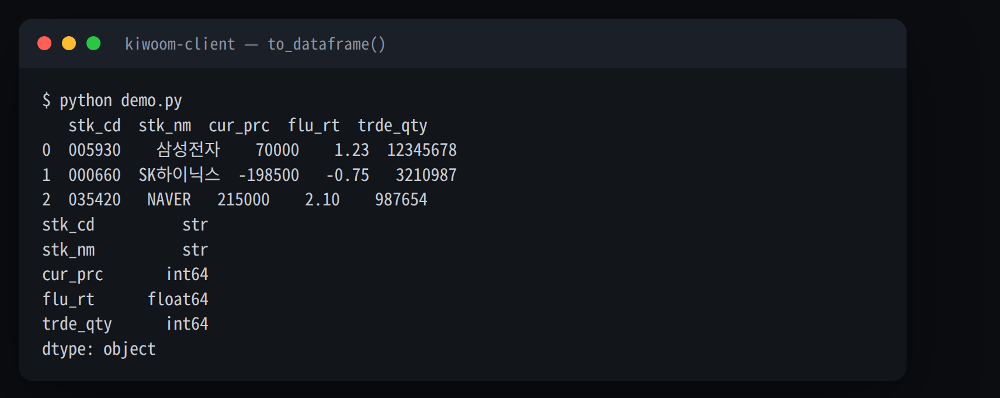
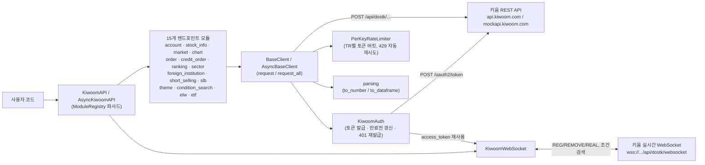

# 사용 가이드

처음이라면 [README](https://github.com/younghwan91/kiwoom-client/blob/main/README.md) 부터.

<!-- toc -->
- [사용법](#사용법)
- [MCP 서버로 사용하기](#mcp-서버로-사용하기)
- [아키텍처](#아키텍처)
- [지원 API 목록](#지원-api-목록)
- [자주 묻는 질문 (FAQ)](#자주-묻는-질문-faq)
<!-- /toc -->

## 사용법

### 계좌와 주문

```python
evaluation = api.account.account_evaluation(qry_tp="0", dmst_stex_tp="KRX")  # 계좌 평가 현황
deposit = api.account.deposit_detail(qry_tp="3")  # 예수금 상세
position = api.account.filled_position(dmst_stex_tp="KRX")  # 체결 잔고
unfilled = api.account.unfilled_orders(all_stk_tp="0", trde_tp="0", stex_tp="0")  # 미체결 주문

# 삼성전자 10주 지정가 매수 — 값은 키움 공식 스펙 기준 (문자열)
result = api.order.buy_order(
    dmst_stex_tp="KRX",  # 거래소 구분: KRX / NXT / SOR
    stk_cd="005930",     # 종목코드
    ord_qty="10",        # 주문 수량
    ord_uv="70000",      # 주문 단가
    trde_tp="0",         # 매매구분: 0 보통(지정가), 3 시장가, 28 스톱지정가 ...
)
api.order.sell_order(dmst_stex_tp="KRX", stk_cd="005930", ord_qty="10", ord_uv="75000", trde_tp="0")
api.order.modify_order(   # 정정 (kt10002)
    dmst_stex_tp="KRX", orig_ord_no="원주문번호", stk_cd="005930", mdfy_qty="5", mdfy_uv="71000",
)
api.order.cancel_order(   # 취소 (kt10003) — cncl_qty="0" 이면 잔량 전부
    dmst_stex_tp="KRX", orig_ord_no="원주문번호", stk_cd="005930", cncl_qty="5",
)

api.logout()  # 토큰 폐기 (선택)
api.close()   # 연결 종료 — with 문을 쓰면 자동
```

지정가(`ord_uv`)는 KRX 호가단위의 배수여야 합니다. 아니면 거부되거나 의도와 다른 가격에 체결됩니다.

```python
from kiwoom_client import add_ticks, round_to_tick, tick_size

tick_size(70123)        # Decimal('100')   (5만~20만원대는 1틱 100원)
round_to_tick(70123)    # Decimal('70100') (직전 유효 호가로 내림)
add_ticks(49950, 2)     # Decimal('50100') (구간 경계를 넘는 N틱 이동)

api.order.buy_order(
    dmst_stex_tp="KRX", stk_cd="005930", ord_qty="10",
    ord_uv=str(round_to_tick(target_price)), trde_tp="0",
)
```

### asyncio

`AsyncKiwoomAPI` 는 `KiwoomAPI` 와 같은 엔드포인트를 제공하며, 호출 앞에 `await` 만 붙이면 됩니다.

```python
import asyncio
from kiwoom_client import AsyncKiwoomAPI

async def main():
    async with AsyncKiwoomAPI(app_key="앱키", app_secret="시크릿키", is_mock=True) as api:
        # 서로 다른 TR은 동시에 나간다 — 직렬로 돌리면 3배 걸린다
        info, chart, ranking = await asyncio.gather(
            api.stock_info.basic_stock_info(stk_cd="005930"),
            api.chart.stock_daily_chart(stk_cd="005930", base_dt="20260326", upd_stkpc_tp="1"),
            api.ranking.top_volume_today(  # ka10030 — 필드는 api.describe("ka10030")
                mrkt_tp="000", sort_tp="1", mang_stk_incls="0", crd_tp="0", trde_qty_tp="0",
                pric_tp="0", trde_prica_tp="0", mrkt_open_tp="0", stex_tp="3",
            ),
        )
        print(info["stk_nm"])

asyncio.run(main())
```

Rate Limiter 는 TR(api_id)별로 걸립니다. 서로 다른 TR 은 서로를 막지 않고 동시에 나가며,
같은 TR 을 반복 호출할 때만 초당 1건으로 조여집니다. 전체 예제는 [`examples/async_usage.py`](https://github.com/younghwan91/kiwoom-client/blob/main/examples/async_usage.py).

### 응답을 숫자·DataFrame으로 받기

키움은 모든 값을 문자열로 돌려줍니다. 가격은 `"+70000"`, 등락률은 `"-1.23"`, 거래량은 `"1,234,567"` 같은 식이라 그대로는 계산에 쓸 수 없습니다.

```python
from kiwoom_client import to_dataframe, to_number, normalize

result = api.ranking.top_volume_today(...)

df = to_dataframe(result)     # 페이로드 키를 자동으로 찾아 DataFrame 으로 (문자열 → 숫자 포함)
print(df["cur_prc"].mean())   # 바로 계산 가능

data = normalize(result)      # dict 그대로 쓰고 싶다면
price = to_number("+70000")   # 70000
```

종목코드(`"005930"`)처럼 앞자리 0 이 의미를 갖는 값과 `base_dt` 같은 날짜·식별자 필드는 문자열로 남깁니다.
`to_dataframe()` 에는 pandas 가 필요합니다(`pip install 'kiwoom-client[pandas]'`).
차트 응답은 `to_ohlcv(resp)` 가 `open/high/low/close/volume` + 날짜 인덱스 DataFrame 으로 바꿉니다.



<sub>샘플 응답을 `to_dataframe()` 에 넣은 실제 출력입니다. 시세 값 자체는 예시입니다 — `stk_cd` 는 문자열로 남고 가격·거래량만 숫자가 되는 것을 보세요.</sub>

### 실시간 WebSocket

```python
import asyncio
from kiwoom_client import KiwoomAPI

api = KiwoomAPI(app_key="앱키", app_secret="시크릿키", is_mock=True)
ws = api.create_websocket()

async def main():
    # connect()가 LOGIN 핸드셰이크까지 끝냅니다. 실패하면 KiwoomWebSocketError
    await ws.connect()

    # 콜백은 REAL 프레임의 항목 하나를 받습니다:
    # {"type": "0B", "item": "005930", "values": {"10": "+70000", ...}}
    ws.on("0B", lambda d: print(f"체결 {d['item']}: {d['values'].get('10')}"))
    ws.on("0D", lambda d: print(f"호가 {d['item']}: {d['values'].get('41')}"))

    # async 콜백도 그대로 등록할 수 있습니다
    async def save(d): ...
    ws.on("0B", save)

    # 삼성전자 실시간 체결+호가 구독
    await ws.subscribe("0B", "005930")
    await ws.subscribe(["0B", "0D"], ["005930", "000660", "035420"])

    # PING 응답과 재연결(재로그인·구독 복원)은 listen()이 알아서 처리합니다
    await ws.listen()

asyncio.run(main())
```

`values` 의 키는 키움 FID 번호입니다(10=현재가, 13=누적거래량, 41=매도최우선호가).

조건검색도 같은 WebSocket 을 씁니다. `api.condition_search` 가 요청 페이로드를 만들고, `ws.send()` 로 보낸 뒤 `ws.on_trnm()` 으로 응답을 받습니다.

```python
await ws.connect()
ws.on_trnm("CNSRLST", lambda d: print("조건식 목록:", d["data"]))
ws.on_trnm("CNSRREQ", lambda d: print("검색 결과:", d.get("data")))

# 조건식 목록을 먼저 조회해야 seq를 알 수 있습니다
await ws.send(api.condition_search.condition_list())

# seq로 검색 (search_type="1"이면 실시간 편입/이탈까지 수신)
await ws.send(api.condition_search.condition_search_realtime(seq="1"))
await ws.listen()
```

> **검증 상태**: 실서버(api.kiwoom.com) 대상으로 LOGIN 핸드셰이크 · PING 프레임 · REG 등록 응답까지 확인했습니다.
> 다만 **REAL 프레임의 항목 필드명(`item`/`values`)은 장 마감 중이라 아직 미확정**입니다. 장중 이상 동작을 만나면
> [이슈](https://github.com/younghwan91/kiwoom-client/issues)로 알려주세요. 직접 확인하려면 `python tests/integration_ws_smoke.py --prod`.

### 연속 조회 (페이지네이션)

응답 헤더의 `cont-yn` 이 `"Y"` 이면 다음 페이지가 있다는 뜻입니다. `request_all()` 이 끝까지 따라갑니다.

```python
all_data = api._client.request_all(
    "/api/dostk/acnt", "ka10076",
    data_key="filled_list",  # 응답에서 리스트 데이터의 키 이름
)
```

### 요청 제한 (Rate Limit)

키움 REST API 는 **TR(api_id)별로 독립적인** 호출 제한을 둡니다. 실측 결과:

| 항목 | 측정값 |
|---|---|
| 지속(sustained) 안전 속도 | **TR당 약 1 req/s** (이 속도에선 거부 0) |
| 순간 버스트(burst) 허용량 | **TR당 약 2건** |
| 초과 시 응답 | HTTP `429` + `{"return_code": 5, "return_msg": "허용된 요청 개수를 초과하였습니다"}` |
| 제한 단위 | **TR(api_id)별 독립** — 서로 다른 TR은 영향 없음 |

라이브러리는 기본으로 **TR별 토큰 버킷(1 req/s, 버스트 2)** 을 걸고, 그래도 `429` 가 나면 **백오프 후 재시도**합니다.

```python
api = KiwoomAPI(app_key="...", app_secret="...", is_mock=True)                                  # 기본값
api = KiwoomAPI(app_key="...", app_secret="...", is_mock=True, rate_limit=2.0, rate_burst=3, max_retries=5)  # 직접 조정
api = KiwoomAPI(app_key="...", app_secret="...", is_mock=True, rate_limit=None)                 # 클라이언트 측 스로틀 끄기
```

> 서로 다른 TR 을 섞어 호출하면 합산 처리량은 더 높습니다. 같은 TR 을 반복(연속조회 루프 등)할 때는 1 req/s 에 수렴합니다 — 이 경우 `request_all()` 을 쓰세요.

### 토큰을 프로세스끼리 나눠 쓰기

토큰은 기본으로 메모리에만 있어, 크론 작업·짧은 스크립트·`kiwoom` CLI 는 실행할 때마다 토큰을 새로 받습니다.
`token_cache=` 에 파일 경로를 주면 받은 토큰을 그 파일에 두고, 같은 앱키로 그 파일을 가리키는 다음 프로세스가 만료 전까지 그대로 씁니다.

```python
api = KiwoomAPI(app_key="...", app_secret="...", is_mock=True, token_cache="~/.cache/kiwoom/token.json")
api = KiwoomAPI.from_env(is_mock=True)   # 환경변수 KIWOOM_TOKEN_CACHE=경로 도 같은 뜻 (CLI 포함)
```

- 파일은 권한 0600 으로 쓰고, 토큰과 만료 시각만 담습니다(앱키·시크릿키는 담지 않습니다). 서버(실전·모의)와 앱키마다 따로 저장합니다.
- 만료 60초 전부터는 쓰지 않고 새로 받습니다. 받은 토큰이 거부되면(401) 평소처럼 재발급하고 파일도 바꿉니다.
- 파일을 읽거나 쓰지 못하면 경고 로그만 남기고 메모리 토큰으로 계속 돕니다.
- 토큰 파일은 비밀번호처럼 다루세요. 공용 서버라면 본인만 읽을 수 있는 경로에 두세요.

### 에러 처리

```python
from kiwoom_client.base import KiwoomAPIError

try:
    result = api.order.buy_order(
        dmst_stex_tp="KRX", stk_cd="005930", ord_qty="10", ord_uv="70000", trde_tp="0",
    )
except KiwoomAPIError as e:
    print(f"에러 코드: {e.code}")
    print(f"에러 메시지: {e.message}")
    print(f"전체 응답: {e.response}")
```

`KiwoomTokenError`·`KiwoomServerMismatchError`(모의/실전 키 불일치)·`KiwoomRateLimitError` 같은 세분 예외도 있고,
모두 `KiwoomAPIError` 하위라 위 코드가 그대로 잡습니다. 원인을 아는 오류는 `e.hint` 에 다음 할 일이 담깁니다.

### 편의 기능

종목명 검색(`api.find_stock`), 코드값 상수(`OrderType.LIMIT`, `Exchange.KRX`), 조회 전용 CLI(`kiwoom quote 005930 --mock`),
마스킹된 `repr`·DEBUG 로그·`timeout=` 은 [편의 기능 문서](https://younghwan91.github.io/kiwoom-client/convenience/)에 모아 두었습니다.

## MCP 서버로 사용하기

<!-- mcp-name: io.github.younghwan91/kiwoom-client (MCP 레지스트리 PyPI 소유 확인용, server.json 참고) -->

Claude Code·Claude Desktop·Cursor·Codex 같은 MCP 클라이언트가 이 라이브러리를 도구로 부릅니다. 모듈 15개의 REST 엔드포인트 전부와 조건검색 4종, 그리고 편의 도구(`stock_search` 종목명→코드, `stock_snapshot`, `account_summary`, 전송하지 않는 `order_preview`)가 노출됩니다.

```bash
uvx --from 'kiwoom-client[mcp]' kiwoom-client-mcp config claude-code   # 붙여넣을 설정 출력 (claude-desktop·cursor·codex 도)
```

| 환경변수 | 설명 | 기본값 |
|---|---|---|
| `KIWOOM_APP_KEY` / `KIWOOM_APP_SECRET` | 앱키·시크릿키 (필수) | — |
| `KIWOOM_IS_MOCK` | 모의투자 서버 사용 여부 (true/false) | `false` |
| `KIWOOM_MCP_TOOLSETS` | 노출할 모듈 (예: `market,chart,account`) | 전부 |
| `KIWOOM_MCP_MODE` | 기본 `smart`(편의 도구 + 메타 도구 3개). `full` 은 TR 도구 전부, `discovery` 는 메타 도구 3개만 | `smart` |
| `KIWOOM_MCP_ALLOW_LIVE_ORDERS` | 실전투자 계좌에서 주문 도구를 노출할지 여부 | `false` |

**실주문 가드**: `KIWOOM_IS_MOCK=false`(실전투자)이고 `KIWOOM_MCP_ALLOW_LIVE_ORDERS` 가 `true` 가 아니면 주문 관련 도구는 서버 시작 시점에 아예 등록되지 않습니다. 도구 목록·toolset 필터·smart/discovery 모드 어디로도 AI 에이전트가 그 도구에 닿지 못합니다. 모의투자(`KIWOOM_IS_MOCK=true`)는 이 가드 없이 항상 사용 가능합니다. 가드는 MCP 서버 경로에만 적용되며, 파이썬 코드에서 `KiwoomAPI`/`AsyncKiwoomAPI` 를 직접 쓰는 방식에는 영향이 없습니다.

클라이언트별 설정, 옵션 전체(`--toolsets`·`--full`·`--discovery`·`--max-rows`), 도구·resources·prompts, 문제 해결은 [MCP 서버 문서](https://younghwan91.github.io/kiwoom-client/mcp/)에 있습니다.

## 아키텍처

`KiwoomAPI`(sync) / `AsyncKiwoomAPI`(async) 는 같은 구조를 공유하는 파사드입니다. 15개 엔드포인트 모듈은 `ModuleRegistry` 가 지연 생성하고, HTTP 호출·인증·재시도는 `BaseClient`/`AsyncBaseClient` 한 곳에 모여 있습니다. 실시간 데이터는 `KiwoomWebSocket` 이 같은 토큰을 재사용해 처리합니다.



## 지원 API 목록

```python
api.login()      # 접근토큰 발급 (선택 — 첫 호출에서 자동 발급됩니다)
api.logout()     # 접근토큰 폐기
```

| 모듈 | 개수 | 설명 |
|---|---|---|
| `api.account` | 33 | 계좌 — 예수금·잔고·손익·증거금·주문내역 |
| `api.stock_info` | 31 | 종목정보 — 기본정보·거래원·신용동향·업종코드 |
| `api.market` | 25 | 시세 — 호가·기관/외국인 매매·프로그램매매 |
| `api.ranking` | 23 | 순위정보 — 거래량·등락률·신용비율·외국인 상위 |
| `api.chart` | 21 | 차트 — 틱·분·일·주·월·년봉 (종목·업종·금현물) |
| `api.elw` | 11 | ELW — 민감도지표·괴리율·조건검색 |
| `api.etf` | 9 | ETF — 수익율·시세·시간대별 체결 |
| `api.order` | 8 | 주문 — 매수·매도·정정·취소 (금현물 포함) |
| `api.sector` | 6 | 업종 — 현재가·지수·투자자 순매수 |
| `api.credit_order` | 4 | 신용주문 — 매수·매도·정정·취소 |
| `api.foreign_institution` | 4 | 기관/외국인 매매 동향 |
| `api.slb` | 4 | 대차거래 — 추이·상위종목 |
| `api.condition_search` | 4 | 조건검색 (WebSocket, `trnm` 기반) |
| `api.theme` | 2 | 테마 — 그룹·구성종목 |
| `api.short_selling` | 1 | 공매도 추이 |
| `api.create_websocket()` | 19종 | 실시간 시세 — 체결·호가·잔고·VI 등 |

182개 메서드의 api_id·한글 TR 이름 전체 표는 [엔드포인트 목록](https://younghwan91.github.io/kiwoom-client/endpoints/)에 있습니다(코드에서 생성). API ID(`ka10001` 등)는 키움 공식 가이드의 TR 코드와 같습니다.

## 자주 묻는 질문 (FAQ)

**Q. sync(`KiwoomAPI`)와 async(`AsyncKiwoomAPI`) 중 뭘 써야 하나요?**
단발성 조회·간단한 스크립트라면 sync 로 충분합니다. 여러 종목을 동시에 조회하거나 실시간 WebSocket 과 함께 쓴다면 async 가 유리합니다.

**Q. 인증 에러(`유효하지 않은 토큰` 등)가 나요.**
토큰 만료라면 라이브러리가 자동으로 재발급 후 재시도합니다. 계속 실패한다면 `is_mock` 값과 앱키/시크릿키가 서로 맞는지 확인하세요 — 모의투자용 키로 실전투자 서버를(또는 반대로) 호출하면 인증이 거부됩니다.

**Q. HTTP `429` 가 계속 떠요.**
기본 Rate Limiter(TR당 1 req/s, 버스트 2)가 있어도, 같은 TR 을 여러 프로세스나 스레드에서 동시에 호출하면 넘길 수 있습니다. `rate_limit` 을 낮추거나 호출을 한 곳에서 조율하세요. [요청 제한](#요청-제한-rate-limit) 참고.

**Q. 지정가 주문(`buy_order`/`sell_order`)이 거부돼요.**
`ord_uv` 가 KRX 호가단위의 배수가 아니면 거부되거나 의도와 다른 가격에 체결됩니다. [`round_to_tick()`](#계좌와-주문)으로 보정한 값을 넘기세요.

**Q. pandas 없이도 쓸 수 있나요?**
네. `to_dataframe()` 만 pandas 가 필요하고, 기본 설치는 dict/list 형태 그대로 응답을 돌려줍니다.

**Q. 연속조회를 직접 관리하지 않고 한 번에 다 받고 싶어요.**
`request_all()` 을 쓰세요. `cont-yn`/`next-key` 를 자동으로 순회합니다. [연속 조회](#연속-조회-페이지네이션) 참고.

더 많은 질문은 [FAQ](https://younghwan91.github.io/kiwoom-client/faq/), 에러 코드별 해결은 [문제 해결](https://younghwan91.github.io/kiwoom-client/troubleshooting/)에 있습니다. 그래도 궁금한 점은 [Issues](https://github.com/younghwan91/kiwoom-client/issues)에 남겨주세요.
